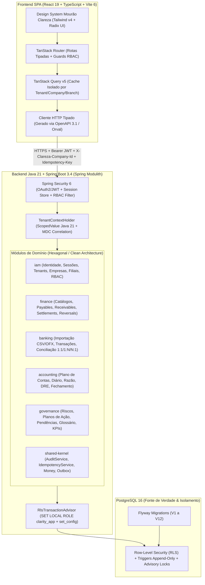

# Plano Diretor de Engenharia e Refatoração (Spec-Driven Development)
## Mourão Clareza Contábil e Financeira — Migração para Java 21 (Spring Boot) + React 19

---

## Parte 1 — Diagnóstico de Engenharia do Projeto Atual (*As-Is*)

### 1.1. Desmistificação da Stack Atual (O que realmente existe no repositório)

Embora houvesse a suspeita inicial de que o projeto estivesse escrito em Python, a inspeção estática completa do repositório mostra que o sistema foi construído sobre um **template híbrido experimental de Node.js/TypeScript e ES Modules (`.mjs`)** originado de um ambiente de prototipação da OpenAI/Cloudflare (`vinext` + `sites-siwc`).

| Camada | Tecnologia Encontrada no Repositório | Arquivos-Chave | Diagnóstico de Engenharia |
| :--- | :--- | :--- | :--- |
| **Runtime & Build** | `vinext 0.0.50` + `next ^16.2.11` + `vite ^8.1.5` + `wrangler ^4.114.0` | `package.json`, `vite.config.ts`, `next.config.ts`, `worker/index.ts`, `build/sites-vite-plugin.ts` | **Crítico (Frankenstein Arquitetural):** Mistura Next.js App Router com Vite RSC e Cloudflare Workers (`D1Database`, `ASSETS`) que não têm relação com o banco PostgreSQL real. |
| **ORM Morto (Lixo de Template)** | `drizzle-orm` + `drizzle-kit` + Cloudflare D1 | `drizzle.config.ts`, `db/schema.ts`, `db/index.ts`, `examples/d1/` | **Alto (Código Morto):** Dependências instaladas e arquivos de configuração apontando para SQLite/D1 que nunca são usados pelo domínio. |
| **Persistência Real** | PostgreSQL 16/17 + Prisma 7 (`@prisma/adapter-pg`) + SQL Nativo | `prisma/schema.prisma`, `server/prisma.ts`, `prisma/migrations/0001_init` a `0007_bank_reconciliation` | **Excelente (Ativo a Preservar):** Modelagem relacional robusta com 24 tabelas, FKs compostas por `(tenant_id, company_id, id)`, RLS forçado (`NOBYPASSRLS`), triggers de projeção e constraints deferrable. |
| **Domínio Backend** | JavaScript puro sem tipos (`.mjs`) + Zod | `server/auth-context.mjs`, `server/tenant-context.mjs`, `server/financial-records.mjs`, `server/financial-events.mjs`, `server/financial-catalogs.mjs`, `server/bank-imports.mjs`, `server/bank-service.mjs` | **Crítico (Baixa Manutenibilidade):** ~3.350 linhas de JavaScript `.mjs` sem tipagem estática, aritmética monetária feita na mão convertendo strings para `BigInt` (`SCALE = 10_000n`), e ausência de separação entre Domínio, Aplicação e Infraestrutura. |
| **Camada HTTP / API** | Next.js Route Handlers (`/api/v1/*`) | `app/api/v1/_shared/financial-collection.ts`, `app/api/v1/_shared/bank-collection.ts`, `app/api/v1/me/route.ts` | **Médio:** Parsing manual de stream de bytes (`parseJsonInput`), mapeamento de exceções por regex em mensagens de erro (`/empresa solicitada\|unidade autorizada/i.test(error.message)`). |
| **Autenticação** | Headers HTTP planos da OpenAI (`oai-authenticated-user-email`) | `app/chatgpt-auth.ts`, `server/auth-context.mjs` | **Crítico (Inseguro fora do proxy OpenAI):** Confia cegamente em cabeçalhos HTTP sem assinatura JWT/OIDC e gera `sessionId: randomUUID()` descartável a cada request. |
| **Frontend UI** | React 19 + Tailwind CSS 4 | `app/command-center.tsx` (927 linhas), `app/financial-workspace.tsx` (1.174 linhas), `app/application-context.tsx`, `app/identity-client.ts` | **Crítico (God Components + Mocks):** Dois arquivos monolíticos concentram mais de 2.100 linhas, misturando estado de UI, chamadas `fetch` manuais, controle de corrida manual e centenas de linhas de constantes demonstrativas (`periods`, `glossary`, DRE fictícia). |

---

### 1.2. Análise Profunda dos Problemas de Engenharia ("Vibecoding Smells")

#### A. Manutenibilidade e Coesão
1. **Ausência de Tipagem Estática no Core Financeiro (`server/*.mjs`):**
   - Enquanto o frontend usa TypeScript (`.ts`/`.tsx`), todo o coração financeiro (`server/financial-records.mjs`, `server/financial-events.mjs`, `server/bank-service.mjs`) foi escrito em JavaScript dinâmico (`.mjs`).
   - Polimorfismo entre Contas a Pagar (`payable`) e Contas a Receber (`receivable`) é feito via strings mágicas e *property lookup* dinâmico (`transaction[config.eventDelegate]`, `record[config.settledAtField]`), impedindo refatoração segura e validação em tempo de compilação.
2. **Aritmética Monetária Improvisada:**
   - Em `server/financial-events.mjs` (`toUnits` / `fromUnits`), valores decimais são convertidos por `String.split(".")` e multiplicados por `10_000n` (`BigInt`). No frontend (`app/financial-workspace.tsx`), a função `money()` refaz o cálculo na mão com `(units + 50n) / 100n`. Em Java, `BigDecimal` com `MonetaryAmount` (JSR 354 / wrapper de domínio imutável `Money`) resolve isso com segurança matemática e de tipos.
3. **Acoplamento por Regex de Mensagem de Erro:**
   - Em `app/api/v1/_shared/financial-collection.ts` (linhas 387–391), a API decide retornar HTTP `403 FORBIDDEN` testando uma expressão regular contra a mensagem em português da exceção (`error instanceof Error && /empresa solicitada|unidade autorizada|contexto autenticado/i.test(error.message)`). Qualquer ajuste de texto quebra o contrato HTTP.
4. **God Components no React:**
   - `app/command-center.tsx` (927 linhas) e `app/financial-workspace.tsx` (1.174 linhas) violam o Princípio da Responsabilidade Única (SRP). `command-center.tsx` contém dados *hardcoded* de Junho/Maio/Abril de 2026, DRE demonstrativa, alertas fictícios e glossário fixo misturados à árvore principal da aplicação.
5. **Working Tree Sujo e Testes Quebrados:**
   - Um rebranding parcial para "Mourão Clareza Contábil e Financeira" alterou 8 arquivos e quebrou `tests/rendered-html.test.mjs` porque o título HTML mudou sem atualização dos contratos de teste.

#### B. Performance e Escalabilidade
1. **Duplo Round-Trip de Banco + CTE Pesada em Todo Request Autenticado:**
   - Em `app/api/v1/_shared/financial-collection.ts` (`requestContext`), **cada requisição HTTP** executa primeiro `resolveIdentityAccess(prisma, identity.email)` (`SELECT * FROM app.resolve_identity_access($1)`), que abre uma conexão do pool, faz loop sobre `auth_identities` e executa 3 `UNION ALL` + `JOIN` em 6 tabelas + `GROUP BY` com `array_agg(DISTINCT permission.code)`.
   - Imediatamente depois, o caso de uso chama `withTenantTransaction` (`server/tenant-context.mjs`), abrindo uma nova transação para executar `SET LOCAL ROLE clarity_app` e `SELECT set_config(...)` antes de rodar a query de negócio.
2. **Recálculo de Projeção em Memória em Cada Liquidação/Estorno:**
   - Em `server/financial-events.mjs` (`createSettlementEvent` e `reverseSettlementEvent`), o serviço carrega **todos** os eventos históricos do título (`loadEvents`) antes da inserção e **novamente todos os eventos** após a inserção para recalcular o saldo em JavaScript e comparar com a trigger do PostgreSQL (`refreshProjection`).
3. **Processamento Síncrono de Upload Bancário em String JSON:**
   - O upload de arquivos CSV/OFX (`POST /api/v1/bank/imports`) recebe o arquivo inteiro serializado dentro de uma string JSON (`content: z.string()`), lendo até ~6 MB na memória da requisição HTTP em vez de usar `multipart/form-data` com streaming ou processamento assíncrono via Transactional Outbox.

#### C. Segurança
1. **Autenticação Baseada em Header Não Assinado (`oai-authenticated-user-email`):**
   - `app/chatgpt-auth.ts` extrai o e-mail diretamente do header `oai-authenticated-user-email`. Sem um gateway que filtre esse header ou sem verificação de token criptográfico (JWT/OIDC), qualquer cliente com acesso direto à porta da aplicação pode forjar qualquer identidade.
2. **Sessão Efêmera Fictícia:**
   - `verifiedSessionForSelection` (`server/auth-context.mjs`, linha 244) cria um `sessionId: randomUUID()` novo a cada chamada HTTP com expiração `Date.now() + 5 * 60_000`. Não existe tabela de sessões ativas, revogação real de sessão (`revokedAt` nunca é populado), rotação de refresh token ou MFA.
3. **Ausência de Rate Limiting, CORS Estrito, CSP e Validação de Cabeçalhos de Segurança.**

#### D. Escopo Funcional Incompleto (Módulos Órfãos)
- **Fase 3 (Conciliação Bancária):** As tabelas `bank_reconciliation_groups`, `bank_reconciliation_items`, `bank_reconciliation_reversals` e `bank_reconciliation_reservations` existem na migration `0007`, mas **não existem serviços, endpoints REST nem interface React** para conciliar (`1:1`, `1:N`, `N:1`) ou desfazer conciliação.
- **Fases 4 a 8 (Contabilidade, Dashboard Real, Riscos, Planos de Ação, Pendências, Glossário):** As tabelas `journal_entries`, `journal_entry_lines`, `glossary_terms`, `pending_items`, `risks` e `action_plans` existem desde a `0001_init`, mas **não possuem nenhum endpoint ou serviço no backend**.

---

## Parte 2 — Arquitetura-Alvo (*To-Be*): Java 21 + Spring Boot 3.4 & React 19

> [!IMPORTANT]
> **Princípio Fundamental da Refatoração:** Não descartaremos a inteligência de banco de dados conquistada nas Fases 0 a 3. As migrations PostgreSQL (`0001` a `0007`), as políticas de RLS, a role restrita `clarity_app` (`NOBYPASSRLS`), as FKs compostas e os triggers de invariantes financeiras serão **preservados e portados para o Flyway**, enquanto o backend `.mjs`/Next.js e o frontend monolítico serão reescritos com engenharia de software de nível corporativo em **Java 21 + Spring Boot 3.4** e **React 19 + TypeScript**.

### 2.1. Topologia da Nova Arquitetura (Monólito Modular Hexagonal)



### 2.2. Estrutura de Diretórios do Repositório Refatorado

```text
clareza-platform/
├── specs/                                      # FONTE DE VERDADE SDD (Spec-Driven Development)
│   ├── openapi/
│   │   └── clareza-api-v1.yaml                 # Contrato OpenAPI 3.1 completo (RFC 9457 Problem Details)
│   ├── schemas/                                # JSON Schemas de eventos de domínio e auditoria
│   ├── features/                               # Especificações BDD (Gherkin .feature) por módulo
│   └── adr/                                    # Architecture Decision Records (ADR-001 a ADR-010)
├── backend/                                    # Java 21 + Spring Boot 3.4 (Maven / Gradle Multi-Package)
│   ├── pom.xml
│   └── src/
│       ├── main/
│       │   ├── java/br/com/mouraoclareza/
│       │   │   ├── ClarezaApplication.java
│       │   │   ├── shared/                     # Shared Kernel
│       │   │   │   ├── domain/                 # Money (BigDecimal 19,4), TenantId, CompanyId, BranchId
│       │   │   │   ├── security/               # TenantContext, ScopedValue, RlsTransactionCallback
│       │   │   │   ├── idempotency/            # IdempotencyTemplate + pg_advisory_xact_lock
│       │   │   │   ├── audit/                  # AuditTrailService (SHA-256 chain)
│       │   │   │   ├── pagination/             # BoundCursorCodec (HMAC/SHA-256 bound cursor)
│       │   │   │   └── web/                    # GlobalExceptionHandler (RFC 9457 ProblemDetail)
│       │   │   ├── iam/                        # Módulo de Identidade, Acesso e Contexto Organizacional
│       │   │   │   ├── domain/
│       │   │   │   ├── application/
│       │   │   │   ├── infrastructure/
│       │   │   │   └── presentation/
│       │   │   ├── finance/                    # Módulo de Núcleo Financeiro Operacional
│       │   │   │   ├── domain/                 # Payable, Receivable, Settlement, Reversal, Catalogs
│       │   │   │   ├── application/
│       │   │   │   ├── infrastructure/
│       │   │   │   └── presentation/
│       │   │   ├── banking/                    # Módulo Bancário e Conciliação
│       │   │   │   ├── domain/                 # BankImport, BankTransaction, ReconciliationGroup
│       │   │   │   ├── application/            # CsvBankParser, OfxBankParser, ReconciliationEngine
│       │   │   │   ├── infrastructure/
│       │   │   │   └── presentation/
│       │   │   ├── accounting/                 # Módulo Contábil (Partidas Dobradas, DRE, Balancete)
│       │   │   └── governance/                 # Módulo de Gestão (Dashboard KPIs, Riscos, Pendências, Glossário)
│       │   └── resources/
│       │       ├── application.yml
│       │       └── db/migration/               # Flyway SQL Migrations (V1__init.sql ... V10__...)
│       └── test/
│           └── java/br/com/mouraoclareza/
│               ├── architecture/               # ArchUnit (regras de coesão, camadas e módulos)
│               ├── integration/                # Testcontainers PostgreSQL 16 (RLS, Concorrência, SQL Gates)
│               └── modules/                    # Testes unitários e de contrato por módulo
└── frontend/                                   # React 19 + TypeScript 5.8 + Vite 6
    ├── package.json
    ├── vite.config.ts
    └── src/
        ├── api/                                # Gerado automaticamente via Orval a partir de specs/openapi/
        ├── app/                                # Providers, TanStack Router, Auth & Context Guards
        ├── components/                         # Design System Mourão Clareza (Atômicos e Acessíveis)
        ├── features/                           # Fatias Verticais de UI (Feature-Sliced Design)
        │   ├── auth/
        │   ├── context-selector/
        │   ├── command-center/
        │   ├── payables/
        │   ├── receivables/
        │   ├── catalogs/
        │   ├── banking-reconciliation/
        │   ├── accounting-dre/
        │   └── governance-risks/
        └── lib/                                # Formatadores monetários seguros, constantes e utils
```

---

## Parte 3 — Metodologia Spec-Driven Development (SDD) para Execução por Agentes

Para que este plano seja executado com precisão determinística por você, pelo **Antigravity** ou pelo **Claude Code**, todas as entregas seguem o ciclo **SDD (Spec-Driven Development)** em 5 etapas obrigatórias por Task:

1. **Passo 1 — Spec Contract First (`specs/`):** Antes de escrever código Java ou React, criar/atualizar a especificação formal (OpenAPI YAML, Flyway SQL DDL, ou Gherkin `.feature`).
2. **Passo 2 — ArchUnit & Contract Skeleton (`backend/src/test`):** Criar o teste de contrato/integração que falha (*Red*) exigindo exatamente os invariantes da Spec.
3. **Passo 3 — Domain & Application Implementation (`backend/src/main`):** Implementar as classes de domínio puras (sem dependências de framework), casos de uso transacionais e adaptadores JPA/JDBC (*Green*).
4. **Passo 4 — Adversarial & Concurrency Verification:** Executar os testes negativos (tentativa de acesso cross-tenant, cross-branch, replay de idempotência com payload adulterado, corrida com `CountDownLatch` em múltiplas threads virtuais).
5. **Passo 5 — Codegen & Frontend Integration (`frontend/src`):** Gerar os tipos/clientes TypeScript a partir do OpenAPI e conectar os componentes React via TanStack Query.

---

## Parte 4 — Mapa de Iniciativas, Épicos e Sprints (Visão Executiva Jira)

| Iniciativa | Épico | Sprints | Objetivo Principal |
| :--- | :--- | :--- | :--- |
| **INIC-01: Fundação & Plataforma Java/React** | **EPIC-01:** Descomissionamento do Legado & Setup Monorepo SDD<br>**EPIC-02:** Shared Kernel (RLS Transacional, Idempotência, Auditoria, `Money`) | Sprint 0<br>Sprint 1 | Eliminar o template Cloudflare/Vinext, configurar Spring Boot 3.4 + Flyway + Testcontainers + React 19 Vite e portar as migrations `V1`–`V7`. |
| **INIC-02: Identidade, Segurança & Multi-Tenancy** | **EPIC-03:** Autenticação JWT/OIDC, Sessões Reais & Diretório RBAC<br>**EPIC-04:** Contexto Organizacional no React (Seletores & Isolamento de Cache) | Sprint 2<br>Sprint 3 | Substituir o header inseguro `oai-authenticated-user-email` por autenticação real com JWT/Sessão revogável, mantendo compatibilidade de testes e o contrato `/api/v1/me`. |
| **INIC-03: Núcleo Financeiro em Java & Decomposição React** | **EPIC-05:** Catálogos Financeiros & Títulos (`Payable` / `Receivable`)<br>**EPIC-06:** Motor de Eventos Financeiros (`Settlement` / `Reversal` / `Timeline`)<br>**EPIC-07:** Refatoração do `financial-workspace.tsx` em Feature Slices | Sprint 4<br>Sprint 5<br>Sprint 6 | Portar toda a Fase 2 de `.mjs` para Java fortemente tipado (`BigDecimal`) e quebrar o componente monolítico de 1.174 linhas em módulos React coesos. |
| **INIC-04: Banking & Conciliação Completa (Fechamento da Fase 3)** | **EPIC-08:** Parsers CSV/OFX Seguros & Importação Bancária em Java<br>**EPIC-09:** Motor de Conciliação Bancária (`1:1`, `1:N`, `N:1`) e Reversão + UI | Sprint 7<br>Sprint 8 | Portar a importação bancária e implementar os serviços, endpoints e telas de Conciliação e Reversão que faltam para fechar a Fase 3. |
| **INIC-05: Motor Contábil, Governança & Fim dos Mocks** | **EPIC-10:** Motor Contábil (Plano de Contas, Partidas Dobradas, DRE Real)<br>**EPIC-11:** Governança, Riscos, Planos de Ação, Glossário e KPIs Reais | Sprint 9<br>Sprint 10<br>Sprint 11 | Dar vida às tabelas órfãs (`journal_entries`, `risks`, `action_plans`, `pending_items`, `glossary_terms`) e eliminar 100% dos mocks de `command-center.tsx`. |
| **INIC-06: Hardening de Produção, Observabilidade & CI/CD** | **EPIC-12:** Observabilidade OpenTelemetry, Performance, Segurança OWASP & CI/CD | Sprint 12 | Preparar o sistema para homologação e produção real com métricas, tracing, rate limiting, SAST, mutation testing e pipelines automatizados. |

---

## Parte 5 — Backlog Detalhado de Épicos, Sprints e Tasks (Padrão Jira + SDD)

---

### INICIATIVA 01 — Fundação & Plataforma Java 21 + React 19

#### EPIC-01: Descomissionamento do Template Legado, Setup Monorepo SDD e Migração Flyway
- **Objetivo:** Limpar artefatos mortos (Cloudflare Workers, D1, Drizzle, Vinext), estruturar o repositório multi-módulo (`specs/`, `backend/`, `frontend/`) e migrar as 7 migrations SQL existentes para o Flyway sem alterar nenhuma regra de banco já provada.

---

##### SPRINT 0 — Fundação Arquitetural, Contratos Base e Banco PostgreSQL 16

###### `[CLZ-001]` Congelamento de Baseline, Limpeza de Artefatos Mortos e Estruturação do Monorepo SDD
- **Tipo:** Task Técnica / Arquitetura | **Prioridade:** P0 (Bloqueante) | **Story Points:** 5 | **Depende de:** Nenhuma
- **Contexto no Código Atual:**
  - O diretório raiz mistura [package.json](file:///Users/luiz/Downloads/CLAREZA_CONTABIL_CODIGO_FONTE_HANDOFF%202/package.json), [worker/index.ts](file:///Users/luiz/Downloads/CLAREZA_CONTABIL_CODIGO_FONTE_HANDOFF%202/worker/index.ts), [drizzle.config.ts](file:///Users/luiz/Downloads/CLAREZA_CONTABIL_CODIGO_FONTE_HANDOFF%202/drizzle.config.ts), [db/schema.ts](file:///Users/luiz/Downloads/CLAREZA_CONTABIL_CODIGO_FONTE_HANDOFF%202/db/schema.ts), `examples/d1/` e [build/sites-vite-plugin.ts](file:///Users/luiz/Downloads/CLAREZA_CONTABIL_CODIGO_FONTE_HANDOFF%202/build/sites-vite-plugin.ts).
  - Além disso, o teste [tests/rendered-html.test.mjs](file:///Users/luiz/Downloads/CLAREZA_CONTABIL_CODIGO_FONTE_HANDOFF%202/tests/rendered-html.test.mjs) falha em 2 asserções porque espera o título antigo `"Clareza | Central de comando empresarial"` enquanto [app/layout.tsx](file:///Users/luiz/Downloads/CLAREZA_CONTABIL_CODIGO_FONTE_HANDOFF%202/app/layout.tsx) já publica `"Mourão Clareza Contábil e Financeira | Central de comando"`.
- **Especificação Técnica (SDD):**
  1. Inicializar repositório Git limpo preservando o bundle histórico (`git-history/clareza-repository.bundle`) como referência e corrigir o contrato do título no legado antes de iniciar a migração.
  2. Criar a árvore SDD canônica:
     - `specs/openapi/clareza-api-v1.yaml`
     - `specs/adr/ADR-001-java21-spring-modulith-architecture.md`
     - `specs/adr/ADR-002-postgresql-rls-transaction-propagation.md`
     - `backend/pom.xml` (Java 21, Spring Boot `3.4.x`, Spring Modulith `1.3.x`, Spring Security, Spring Data JPA, Spring JDBC, Flyway, PostgreSQL Driver, Jackson Datatype JSR310, Validation, Micrometer, Testcontainers, ArchUnit, JUnit 5).
     - `frontend/package.json` (React 19, TypeScript 5.8, Vite 6, Tailwind CSS 4, `@tanstack/react-router`, `@tanstack/react-query`, `react-hook-form`, `zod`, `lucide-react`, `vitest`, `@testing-library/react`, `@playwright/test`).
- **Critérios de Aceite (BDD):**
  - **Given** o monorepo configurado com `backend/` e `frontend/`
  - **When** o agente executar `mvn test-compile` em `backend/` e `npm run typecheck` em `frontend/`
  - **Then** ambos os builds devem compilar com zero erros e sem dependências de Cloudflare Workers, Drizzle ou Vinext.
- **Gate de Verificação (DoD):**
  - `mvn -f backend/pom.xml validate` passa;
  - `ArchUnit` valida que nenhum pacote em `domain` depende de `org.springframework.*` ou `jakarta.persistence.*` (exceto anotações estritamente autorizadas se mapeamento direto for evitado via entidades de persistência ou Value Objects puros).

---

###### `[CLZ-002]` Portabilidade Integral das Migrations `0001` a `0007` para Flyway e Validação em PostgreSQL 16 Real
- **Tipo:** Task de Banco de Dados | **Prioridade:** P0 | **Story Points:** 8 | **Depende de:** `CLZ-001`
- **Contexto no Código Atual:**
  - As migrations atuais residem em:
    - [0001_init/migration.sql](file:///Users/luiz/Downloads/CLAREZA_CONTABIL_CODIGO_FONTE_HANDOFF%202/prisma/migrations/0001_init/migration.sql)
    - [0002_identity_bootstrap_and_branch_rls/migration.sql](file:///Users/luiz/Downloads/CLAREZA_CONTABIL_CODIGO_FONTE_HANDOFF%202/prisma/migrations/0002_identity_bootstrap_and_branch_rls/migration.sql)
    - [0003_financial_api_foundation/migration.sql](file:///Users/luiz/Downloads/CLAREZA_CONTABIL_CODIGO_FONTE_HANDOFF%202/prisma/migrations/0003_financial_api_foundation/migration.sql)
    - [0004_identity_branch_directory/migration.sql](file:///Users/luiz/Downloads/CLAREZA_CONTABIL_CODIGO_FONTE_HANDOFF%202/prisma/migrations/0004_identity_branch_directory/migration.sql)
    - [0005_financial_operations/migration.sql](file:///Users/luiz/Downloads/CLAREZA_CONTABIL_CODIGO_FONTE_HANDOFF%202/prisma/migrations/0005_financial_operations/migration.sql)
    - [0006_phase_two_hardening/migration.sql](file:///Users/luiz/Downloads/CLAREZA_CONTABIL_CODIGO_FONTE_HANDOFF%202/prisma/migrations/0006_phase_two_hardening/migration.sql)
    - [0007_bank_reconciliation/migration.sql](file:///Users/luiz/Downloads/CLAREZA_CONTABIL_CODIGO_FONTE_HANDOFF%202/prisma/migrations/0007_bank_reconciliation/migration.sql)
- **Especificação Técnica (SDD):**
  1. Copiar e versionar as migrations sob `backend/src/main/resources/db/migration/` seguindo a nomenclatura estrita do Flyway:
     - `V1__init.sql`
     - `V2__identity_bootstrap_and_branch_rls.sql`
     - `V3__financial_api_foundation.sql`
     - `V4__identity_branch_directory.sql`
     - `V5__financial_operations.sql`
     - `V6__phase_two_hardening.sql`
     - `V7__bank_reconciliation.sql`
  2. Preservar **100% das cláusulas SQL**: role `clarity_app` (`NOLOGIN NOSUPERUSER NOCREATEDB NOCREATEROLE NOINHERIT NOBYPASSRLS`), schema `app`, functions `app.current_tenant_id()`, `app.current_user_id()`, `app.current_company_ids()`, `app.current_branch_ids()`, `app.can_access_record()`, `app.can_access_catalog()`, policies de RLS e triggers de invariantes.
  3. Portar os scripts de seed ([prisma/seed.sql](file:///Users/luiz/Downloads/CLAREZA_CONTABIL_CODIGO_FONTE_HANDOFF%202/prisma/seed.sql) e [prisma/phase-zero-seed.sql](file:///Users/luiz/Downloads/CLAREZA_CONTABIL_CODIGO_FONTE_HANDOFF%202/prisma/phase-zero-seed.sql)) para `backend/src/test/resources/db/seed/` e o gate SQL [tests/sql/phase3-bank-reconciliation-gate.sql](file:///Users/luiz/Downloads/CLAREZA_CONTABIL_CODIGO_FONTE_HANDOFF%202/tests/sql/phase3-bank-reconciliation-gate.sql) para um teste automatizado JUnit 5 + Testcontainers (`PostgreSqlMigrationsAndInvariantsIntegrationTest`).
- **Critérios de Aceite (BDD):**
  - **Given** um container `postgres:16-alpine` vazio iniciado pelo Testcontainers
  - **When** o Flyway executar `migrate()`
  - **Then** as 7 migrations devem ser aplicadas com sucesso, todas as 24 tabelas devem ter RLS ativo (exceto projeções internas protegidas por `REVOKE ALL`), e o script `phase3-bank-reconciliation-gate.sql` deve passar integralmente.
- **Gate de Verificação (DoD):**
  - `mvn test -Dtest=PostgreSqlMigrationsAndInvariantsIntegrationTest` 100% verde.

---

#### EPIC-02: Shared Kernel em Java 21 (Money, RLS Transacional, Idempotência, Auditoria e Erros RFC 9457)
- **Objetivo:** Construir os blocos fundacionais transversais em Java 21 que substituem `server/tenant-context.mjs` e as funções repetidas de hash/idempotência/auditoria espalhadas pelos arquivos `.mjs`.

---

##### SPRINT 1 — Shared Kernel, Isolamento Transacional RLS e Infraestrutura Cross-Cutting

###### `[CLZ-003]` Implementação de Value Objects de Domínio (`Money`, `TenantId`, `CompanyId`, `BranchId`, `UserId`, `CurrencyCode`)
- **Tipo:** Task de Domínio | **Prioridade:** P0 | **Story Points:** 5 | **Depende de:** `CLZ-001`
- **Contexto no Código Atual:**
  - Substitui a manipulação manual de strings e `BigInt` (`SCALE = 10_000n`, `MAX_MONEY_UNITS = 9_999_999_999_999_999_999n`) em [server/financial-events.mjs](file:///Users/luiz/Downloads/CLAREZA_CONTABIL_CODIGO_FONTE_HANDOFF%202/server/financial-events.mjs#L20-L23) e as validações de regex UUID repetidas em todos os módulos `.mjs`.
- **Especificação Técnica (SDD):**
  1. `Money` (`record Money(BigDecimal value)`):
     - Escala fixa `4` (`NUMERIC(19,4)`), `RoundingMode.UNNECESSARY` no parsing de entrada (rejeita mais de 4 casas decimais com erro de validação `INVALID_DECIMAL`) e máximo de 15 dígitos inteiros (`999_999_999_999_999.9999`).
     - Proíbe construtores com `double` ou `float`. Aceita apenas `String` validada por regex `^[+-]?\d{1,15}(?:\.\d{1,4})?$` ou `BigDecimal`.
     - Métodos seguros: `add(Money)`, `subtract(Money)`, `isPositive()`, `isZero()`, `isNegative()`, `toCanonicalString()` (sempre formatado com 4 casas decimais `0.0000`, ex.: `"150.5000"`).
  2. Identificadores fortemente tipados (`record TenantId(UUID value)`, `CompanyId`, `BranchId`, `UserId`, `FinancialAccountId`, `PayableId`, `ReceivableId`):
     - Normalizam strings UUID para lowercase e lançam exceção tipada se inválidos.
- **Critérios de Aceite (BDD):**
  - **Given** uma instância `Money.of("100.5")`
  - **When** serializada para JSON ou comparada com `Money.of("100.5000")`
  - **Then** `toCanonicalString()` retorna `"100.5000"`, `equals()` é `true`, e valores com 5 casas decimais (`"10.12345"`) ou `> 15` dígitos inteiros lançam `DomainValidationException`.
- **Gate de Verificação (DoD):**
  - Testes unitários parametrizados cobrindo limites positivos, negativos, zero, overflow de 15 inteiros e rejeição de separador de milhar ambíguo.

---

###### `[CLZ-004]` Mecanismo Transacional de Propagação de Contexto e RLS (`TenantContextHolder` + `RlsTransactionExecutor`)
- **Tipo:** Task de Segurança & Banco | **Prioridade:** P0 | **Story Points:** 8 | **Depende de:** `CLZ-002`, `CLZ-003`
- **Contexto no Código Atual:**
  - Substitui [server/tenant-context.mjs](file:///Users/luiz/Downloads/CLAREZA_CONTABIL_CODIGO_FONTE_HANDOFF%202/server/tenant-context.mjs#L241-L273) (`AsyncLocalStorage` + `withTenantTransaction`).
- **Especificação Técnica (SDD):**
  1. Definir `AuthenticatedTenantContext` (`record` imutável):
     ```java
     public record AuthenticatedTenantContext(
         TenantId tenantId,
         UserId userId,
         UUID sessionId,
         Set<CompanyId> companyIds,
         Set<CompanyId> branchCompanyIds,
         Set<BranchId> branchIds,
         CompanyId activeCompanyId,
         BranchId activeBranchId, // nullable quando acesso é de nível empresa
         boolean tenantWideAccess,
         Set<String> permissions,
         String authenticationSource
     ) {}
     ```
  2. Implementar `TenantContextHolder` usando `ScopedValue<AuthenticatedTenantContext>` (Java 21) ou `ThreadLocal` limpo por `try-with-resources`, falhando fechado (`AuthenticationRequiredException`) quando ausente.
  3. Implementar `RlsTransactionExecutor`:
     - Abre transação Spring (`TransactionTemplate` com `PROPAGATION_REQUIRED`).
     - Executa imediatamente via `JdbcTemplate` na mesma conexão física:
       ```sql
       SET LOCAL ROLE clarity_app;
       SELECT
         set_config('app.tenant_id', ?, true),
         set_config('app.user_id', ?, true),
         set_config('app.company_ids', ?, true),
         set_config('app.branch_ids', ?, true),
         set_config('app.tenant_wide_access', ?, true);
       ```
     - Ao encerrar a transação (commit ou rollback), o PostgreSQL descarta automaticamente o `SET LOCAL ROLE` e as configurações `set_config(..., true)`, garantindo **zero vazamento de contexto no HikariCP connection pool**.
  4. Criar regra `ArchUnit` que proíbe qualquer `@Repository` de ser invocado fora de `RlsTransactionExecutor`.
- **Critérios de Aceite (BDD):**
  - **Given** um pool HikariCP configurado com apenas 1 conexão física (`maximumPoolSize = 1`)
  - **When** a Requisição A (Tenant 1) executa uma query, seguida de uma Requisição B (Tenant 2) e uma Requisição C (sem contexto configurado)
  - **Then** a Requisição A vê apenas dados do Tenant 1, a Requisição B vê apenas dados do Tenant 2, e a Requisição C retorna zero registros ou falha fechada sem herdar o contexto da Requisição B.
- **Gate de Verificação (DoD):**
  - Suíte `RlsConnectionPoolIsolationIntegrationTest` com Testcontainers 100% aprovada.

---

###### `[CLZ-005]` Serviço Transversal de Idempotência Concorrente (`IdempotencyExecutor`) e Auditoria Imutável (`AuditTrailService`)
- **Tipo:** Task de Infraestrutura & Segurança | **Prioridade:** P0 | **Story Points:** 8 | **Depende de:** `CLZ-004`
- **Contexto no Código Atual:**
  - No código legado, a lógica de `pg_advisory_xact_lock(hashtextextended($1, 0))`, busca em `idempotency_records`, cálculo de `requestHash` e gravação em `audit_logs` com `integrityHash` está **copiada e colada** em 4 lugares diferentes:
    - [server/financial-records.mjs](file:///Users/luiz/Downloads/CLAREZA_CONTABIL_CODIGO_FONTE_HANDOFF%202/server/financial-records.mjs#L335-L458)
    - [server/financial-events.mjs](file:///Users/luiz/Downloads/CLAREZA_CONTABIL_CODIGO_FONTE_HANDOFF%202/server/financial-events.mjs#L460-L563)
    - [server/financial-catalogs.mjs](file:///Users/luiz/Downloads/CLAREZA_CONTABIL_CODIGO_FONTE_HANDOFF%202/server/financial-catalogs.mjs#L289-L353)
    - [server/bank-service.mjs](file:///Users/luiz/Downloads/CLAREZA_CONTABIL_CODIGO_FONTE_HANDOFF%202/server/bank-service.mjs#L306-L489)
- **Especificação Técnica (SDD):**
  1. Centralizar em `IdempotencyExecutor`:
     - Valida header `Idempotency-Key` contra `^[A-Za-z0-9._:-]{8,128}$`.
     - Calcula `requestHash` SHA-256 canônico (JSON ordenado com `MapperFeature.SORT_PROPERTIES_ALPHABETICALLY`) incluindo `(operation, tenantId, companyId, branchId, payload)`.
     - Adquire lock transacional no PostgreSQL:
       `SELECT pg_advisory_xact_lock(hashtextextended(?, 0))::text` onde `lockScope = tenantId + ":" + userId + ":" + operation + ":" + idempotencyKey`.
     - Consulta `idempotency_records`. Se existir:
       - Se `existing.requestHash != hash`, lança `IdempotencyConflictException` (HTTP `409 IDEMPOTENCY_CONFLICT`).
       - Se igual, retorna `IdempotentResult<T>` com `replayed = true` (que adiciona o header `Idempotency-Replayed: true`).
     - Se não existir, executa a mutação de domínio + `AuditTrailService.record(...)` + persiste `idempotency_records` (expiração de 24h) na **mesma transação**.
  2. Centralizar em `AuditTrailService`:
     - Constrói o registro em `audit_logs` com redação automática de campos sensíveis (`counterpartyName`, `taxId`), calcula `integrity_hash` SHA-256 canônico e insere na mesma transação. Se a inserção da auditoria falhar, toda a transação sofre rollback.
- **Critérios de Aceite (BDD):**
  - **Given** 10 Virtual Threads disparando simultaneamente a mesma mutação com a mesma `Idempotency-Key` e mesmo payload
  - **When** processadas pelo `IdempotencyExecutor`
  - **Then** apenas 1 registro de domínio e 1 `AuditLog` são criados no banco, 1 thread recebe `replayed=false` e 9 threads recebem `replayed=true` com o mesmo `resourceId`.
  - **Given** uma requisição reutilizando a mesma `Idempotency-Key` com payload diferente
  - **When** processada pelo `IdempotencyExecutor`
  - **Then** retorna HTTP `409 Conflict` (`code: "IDEMPOTENCY_CONFLICT"`).
- **Gate de Verificação (DoD):**
  - Testes de concorrência real e atomicidade de rollback (`IdempotencyAndAuditAtomicityIntegrationTest`) verdes.

---

###### `[CLZ-006]` Padronização de Respostas de Erro (RFC 9457 Problem Details) e Cursores Vinculados ao Contexto (`BoundCursorCodec`)
- **Tipo:** Task de API / Plataforma | **Prioridade:** P1 | **Story Points:** 5 | **Depende de:** `CLZ-004`
- **Contexto no Código Atual:**
  - Substitui a função `problem()` de [app/api/v1/_shared/financial-collection.ts](file:///Users/luiz/Downloads/CLAREZA_CONTABIL_CODIGO_FONTE_HANDOFF%202/app/api/v1/_shared/financial-collection.ts#L44-L62) e a codificação de cursor vinculada ao escopo de [server/bank-service.mjs](file:///Users/luiz/Downloads/CLAREZA_CONTABIL_CODIGO_FONTE_HANDOFF%202/server/bank-service.mjs#L120-L156).
  - Nota: Em [server/financial-records.mjs](file:///Users/luiz/Downloads/CLAREZA_CONTABIL_CODIGO_FONTE_HANDOFF%202/server/financial-records.mjs#L289-L304), o cursor de títulos financeiros (`encodeCursor(id)`) **não** tinha binding de contexto (diferente do `bank-service.mjs` que já tinha `version: 1, id, binding`). Na refatoração, unificaremos todos os cursores sob o padrão mais seguro!
- **Especificação Técnica (SDD):**
  1. `GlobalExceptionHandler` (`@RestControllerAdvice`):
     - Produz JSON compatível com o contrato existente:
       ```json
       {
         "type": "https://clareza.example/problems/validation_error",
         "title": "Revise os campos informados.",
         "status": 422,
         "code": "VALIDATION_ERROR",
         "requestId": "uuid-v4",
         "errors": [{ "field": "amount", "code": "AMOUNT_NOT_POSITIVE", "message": "..." }]
       }
       ```
     - Mapeia hierarquia de exceções selada (`sealed interface ClarezaException`), eliminando 100% dos checks por regex em mensagens de erro.
  2. `BoundCursorCodec`:
     - Gera cursor `base64url` contendo `{"version":1,"id":"<uuid>","binding":"<sha256(resource,tenantId,companyId,branchId,filters,order)>"}`.
     - Qualquer tentativa de reutilizar um cursor após trocar de empresa, unidade ou filtro lança `InvalidCursorException` (HTTP `422 INVALID_CURSOR`).
- **Critérios de Aceite (BDD):**
  - **Given** um cursor obtido na listagem da Empresa A
  - **When** enviado na listagem da Empresa B ou com outro filtro `status`
  - **Then** o servidor rejeita com HTTP `422` e `code: "INVALID_CURSOR"`.

---

### INICIATIVA 02 — Identidade, Segurança & Multi-Tenancy (Java + React)

#### EPIC-03: Autenticação Definitiva (JWT/OIDC + Adapter Dev/Test), Sessões Reais e Diretório RBAC (`/api/v1/me`)
- **Objetivo:** Substituir a dependência frágil de `app/chatgpt-auth.ts` e `server/auth-context.mjs` por um módulo `iam` em Spring Security 6 que suporte autenticação real (JWT/OAuth2 + Sessão Revogável) e mantenha um modo controlado de teste/proxy para não quebrar a suíte de regressão existente.

---

##### SPRINT 2 — Módulo IAM Backend e Contrato `/api/v1/me`

###### `[CLZ-007]` Migration `V8__user_sessions_and_auth_hardening.sql` e Resolução Otimizada de Identidade
- **Tipo:** Task de Segurança & Banco | **Prioridade:** P0 | **Story Points:** 8 | **Depende de:** `CLZ-004`
- **Contexto no Código Atual:**
  - Em [server/auth-context.mjs](file:///Users/luiz/Downloads/CLAREZA_CONTABIL_CODIGO_FONTE_HANDOFF%202/server/auth-context.mjs#L58-L74) e [0002_identity_bootstrap_and_branch_rls/migration.sql](file:///Users/luiz/Downloads/CLAREZA_CONTABIL_CODIGO_FONTE_HANDOFF%202/prisma/migrations/0002_identity_bootstrap_and_branch_rls/migration.sql#L174-L344), a função `app.resolve_identity_access(verified_email)` está hardcoded para `identity.provider = 'sites-siwc'` e é reexecutada em **toda** requisição HTTP.
- **Especificação Técnica (SDD):**
  1. Criar migration `V8__user_sessions_and_auth_hardening.sql`:
     - Cria tabela `user_sessions` (`id`, `tenant_id`, `user_id`, `token_hash`, `ip_hash`, `user_agent`, `expires_at`, `revoked_at`, `created_at`) com RLS.
     - Sobrescreve `app.resolve_identity_access(verified_email text, auth_provider text DEFAULT 'sites-siwc')` mantendo compatibilidade com chamadas de 1 parâmetro (`resolve_identity_access(text)`) para suportar tanto OIDC/JWT corporativo quanto o provider legado nos testes.
  2. Implementar `IdentityAccessDirectoryService` em Java:
     - Executa `SELECT * FROM app.resolve_identity_access(?, ?)` e constrói o grafo imutável `IdentitySummaryDto` (`email`, `displayName`, `tenants -> companies -> branches + permissions + scopes`), preservando exatamente a regra de herança de permissões de [server/auth-context.mjs](file:///Users/luiz/Downloads/CLAREZA_CONTABIL_CODIGO_FONTE_HANDOFF%202/server/auth-context.mjs#L76-L173) (onde escopos `TENANT` e `COMPANY` propagam suas permissões para todas as filiais ativas da empresa).
  3. Implementar cache de curta duração invalidável ou claims assinados na sessão para evitar que toda chamada `/api/v1/payables` precise recomputar o diretório inteiro antes de abrir a transação de negócio.
- **Critérios de Aceite (BDD):**
  - **Given** um usuário autenticado com membership `COMPANY` na Empresa 1 e `BRANCH` apenas na Filial B da Empresa 2
  - **When** consultar `GET /api/v1/me`
  - **Then** o payload JSON retornado pelo backend Java deve ser 100% idêntico (schema, ordenação de arrays e códigos de erro `401 AUTHENTICATION_REQUIRED`, `403 MEMBERSHIP_REQUIRED`, `503 DATABASE_UNAVAILABLE`) ao de [app/api/v1/me/route.ts](file:///Users/luiz/Downloads/CLAREZA_CONTABIL_CODIGO_FONTE_HANDOFF%202/app/api/v1/me/route.ts).
- **Gate de Verificação (DoD):**
  - Todos os cenários equivalentes a [tests/auth-context.test.mjs](file:///Users/luiz/Downloads/CLAREZA_CONTABIL_CODIGO_FONTE_HANDOFF%202/tests/auth-context.test.mjs) e [tests/api-auth.test.mjs](file:///Users/luiz/Downloads/CLAREZA_CONTABIL_CODIGO_FONTE_HANDOFF%202/tests/api-auth.test.mjs) passando em JUnit 5 (`MeControllerContractTest`).

---

###### `[CLZ-008]` Filtro de Segurança de Contexto (`ClarezaContextFilter`) e Validação de Headers `x-clareza-company-id` / `x-clareza-branch-id`
- **Tipo:** Task de Segurança | **Prioridade:** P0 | **Story Points:** 5 | **Depende de:** `CLZ-007`
- **Contexto no Código Atual:**
  - Substitui `verifiedSessionForSelection` em [server/auth-context.mjs](file:///Users/luiz/Downloads/CLAREZA_CONTABIL_CODIGO_FONTE_HANDOFF%202/server/auth-context.mjs#L183-L248) e `requestContext` em [app/api/v1/_shared/financial-collection.ts](file:///Users/luiz/Downloads/CLAREZA_CONTABIL_CODIGO_FONTE_HANDOFF%202/app/api/v1/_shared/financial-collection.ts#L64-L86).
- **Especificação Técnica (SDD):**
  1. `ClarezaContextFilter` (`OncePerRequestFilter` do Spring Security):
     - Ignora headers maliciosos enviados pelo cliente (`x-clareza-tenant-id`, `x-clareza-user-id`, `x-clareza-actor-id`).
     - Para endpoints de domínio (`/api/v1/financial/**`, `/api/v1/payables/**`, `/api/v1/receivables/**`, `/api/v1/bank/**`, `/api/v1/accounting/**`, `/api/v1/governance/**`):
       - Exige `x-clareza-company-id` (se ausente, retorna `409 COMPANY_CONTEXT_REQUIRED`).
       - Valida se `companyId` e `branchId` (`x-clareza-branch-id`) são UUIDs válidos (se malformados, retorna `400 INVALID_CONTEXT_SELECTION` com `field: "companyId"` ou `"branchId"`).
       - Verifica se a empresa e a filial pertencem às memberships ativas da identidade autenticada (se não pertencerem, retorna `403 FORBIDDEN`).
       - Se o usuário só tiver escopo `BRANCH` na empresa e não informar `x-clareza-branch-id`, nega com `403 FORBIDDEN`.
       - Popula `TenantContextHolder` para a execução do controller.
- **Critérios de Aceite (BDD):**
  - **Given** um usuário autenticado apenas na Filial Norte (`BRANCH`)
  - **When** tentar chamar qualquer API sem `x-clareza-branch-id` ou com o UUID da Filial Sul
  - **Then** a requisição é bloqueada no filtro com HTTP `403 FORBIDDEN` antes de tocar no serviço de domínio.

---

#### EPIC-04: Fundação do Frontend React 19 (Vite + TypeScript + Design System Mourão Clareza + Contexto)
- **Objetivo:** Criar a aplicação React 19 desacoplada com Vite, consolidar definitivamente o rebranding **Mourão Clareza Contábil e Financeira** (que estava sujo no working tree) e estruturar o gerenciamento de estado e contexto.

---

##### SPRINT 3 — Frontend Core, Design System Mourão Clareza e Contexto Organizacional

###### `[CLZ-009]` Setup do Frontend React 19 + Vite 6 + Geração Automática de Cliente OpenAPI + Design System Mourão Clareza
- **Tipo:** Task de Frontend | **Prioridade:** P0 | **Story Points:** 5 | **Depende de:** `CLZ-001`, `CLZ-007`
- **Contexto no Código Atual:**
  - Consolida as alterações visuais que estavam não commitadas em [app/globals.css](file:///Users/luiz/Downloads/CLAREZA_CONTABIL_CODIGO_FONTE_HANDOFF%202/app/globals.css), [app/layout.tsx](file:///Users/luiz/Downloads/CLAREZA_CONTABIL_CODIGO_FONTE_HANDOFF%202/app/layout.tsx), [app/application.tsx](file:///Users/luiz/Downloads/CLAREZA_CONTABIL_CODIGO_FONTE_HANDOFF%202/app/application.tsx) e os ativos em `public/brand/mourao-*`.
- **Especificação Técnica (SDD):**
  1. Configurar tokens do Design System **Mourão Clareza** em `frontend/src/styles/theme.css`:
     - Paleta institucional: Azul-Marinho Base (`#0B192C` / `#102542`), Dourado Acento (`#C5A059` — nunca usado para texto pequeno sobre fundo claro para garantir contraste WCAG AA), Marfim/Superfície (`#FBF9F5` / `#FFFFFF`), semânticas de sucesso (`#15803D`), alerta (`#B45309`) e erro (`#B91C1C`).
     - Tipografia mínima operacional: `>= 12px` (`0.75rem`) em todas as tabelas, badges e timelines.
     - Título oficial da aplicação: `"Mourão Clareza Contábil e Financeira | Central de comando"`.
  2. Configurar Orval (`orval.config.ts`) para ler `specs/openapi/clareza-api-v1.yaml` e gerar hooks do TanStack Query v5 e tipos TypeScript estritos.
- **Critérios de Aceite (BDD):**
  - **Given** a aplicação React compilada pelo Vite
  - **When** inspecionada em viewport Desktop (`1440x900`) e Mobile (`390x844`)
  - **Then** exibe a logo e brasão Mourão Clareza, respeita contraste WCAG AA, não possui overflow horizontal na página e passa nos testes de contrato visual.

---

###### `[CLZ-010]` Migração e Refatoração do `ApplicationContextProvider` + Integração com TanStack Query Cache Isolation
- **Tipo:** Task de Frontend & Segurança | **Prioridade:** P0 | **Story Points:** 5 | **Depende de:** `CLZ-009`
- **Contexto no Código Atual:**
  - Refatora [app/identity-client.ts](file:///Users/luiz/Downloads/CLAREZA_CONTABIL_CODIGO_FONTE_HANDOFF%202/app/identity-client.ts) e [app/application-context.tsx](file:///Users/luiz/Downloads/CLAREZA_CONTABIL_CODIGO_FONTE_HANDOFF%202/app/application-context.tsx).
- **Especificação Técnica (SDD):**
  1. Preservar todas as garantias já testadas em [tests/identity-interface.test.mjs](file:///Users/luiz/Downloads/CLAREZA_CONTABIL_CODIGO_FONTE_HANDOFF%202/tests/identity-interface.test.mjs):
     - Chaves de preferência `clareza.navigation.company.v1` e `clareza.navigation.branch.v1` em `localStorage` tratadas como **preferências não confiáveis** (descartadas imediatamente se não constarem no retorno de `/api/v1/me`).
     - Estados explícitos de sessão: `loading`, `unauthenticated` (401), `forbidden` (403), `unavailable` (503), `error`, `empty` e `ready`.
     - `createLatestRequestGate()` + `AbortController` para descartar respostas atrasadas durante trocas rápidas de empresa ou unidade.
  2. Integrar com `QueryClient` do TanStack Query:
     - Toda `queryKey` de domínio inclui obrigatoriamente o prefixo `["context", navigation.fingerprint, ...]` (`tenantId:companyId:branchId`).
     - Ao trocar de empresa ou filial (`selectCompany` / `selectBranch`), todas as queries em voo do contexto anterior são canceladas (`queryClient.cancelQueries`) e os componentes operacionais recebem `key={navigation.fingerprint}` para remount limpo.
- **Critérios de Aceite (BDD):**
  - **Given** um usuário que adultera `localStorage.setItem("clareza.navigation.company.v1", "uuid-nao-autorizado")`
  - **When** a aplicação inicializa
  - **Then** a preferência inválida é removida do `localStorage` e o contexto seleciona apenas a primeira empresa autorizada pelo backend.
- **Gate de Verificação (DoD):**
  - Suíte Vitest portando 100% dos testes de `identity-interface.test.mjs` + novos testes de cancelamento de cache TanStack Query.

---

### INICIATIVA 03 — Núcleo Financeiro Operacional em Java & Decomposição React (Fase 2 Refatorada)

#### EPIC-05: Catálogos Financeiros e Títulos (`Payable` & `Receivable`) em Java 21
- **Objetivo:** Portar [server/financial-catalogs.mjs](file:///Users/luiz/Downloads/CLAREZA_CONTABIL_CODIGO_FONTE_HANDOFF%202/server/financial-catalogs.mjs) e [server/financial-records.mjs](file:///Users/luiz/Downloads/CLAREZA_CONTABIL_CODIGO_FONTE_HANDOFF%202/server/financial-records.mjs) para o módulo `finance` no Spring Boot com DDD, mantendo 100% de paridade nos contratos REST e invariantes PostgreSQL.

---

##### SPRINT 4 — Catálogos Financeiros e Gestão de Títulos a Pagar e a Receber

###### `[CLZ-011]` Domínio, Repositórios e APIs de Catálogos Financeiros (`GET/POST /api/v1/financial/catalogs`)
- **Tipo:** Task Backend (Java) | **Prioridade:** P0 | **Story Points:** 5 | **Depende de:** `CLZ-005`, `CLZ-008`
- **Contexto no Código Atual:**
  - Substitui [server/financial-catalogs.mjs](file:///Users/luiz/Downloads/CLAREZA_CONTABIL_CODIGO_FONTE_HANDOFF%202/server/financial-catalogs.mjs) (363 linhas) e [app/api/v1/financial/catalogs/route.ts](file:///Users/luiz/Downloads/CLAREZA_CONTABIL_CODIGO_FONTE_HANDOFF%202/app/api/v1/financial/catalogs/route.ts).
- **Especificação Técnica (SDD):**
  1. Entidades de Domínio e Enums no pacote `br.com.mouraoclareza.finance.domain.catalog`:
     - `Counterparty` (`kind`: `SUPPLIER`, `CUSTOMER`, `BOTH`; `taxId` redigido na auditoria).
     - `FinancialCategory` (`direction`: `PAYABLE`, `RECEIVABLE`, `BOTH`).
     - `CostCenter`.
     - `FinancialAccount` (`type`: `CASH`, `CHECKING`, `SAVINGS`, `PAYMENT`, `OTHER`; `currencyCode`: `^[A-Z]{3}$`).
  2. Regras de Negócio e Visibilidade:
     - `GET /api/v1/financial/catalogs`: Requer permissão `financial.view`. Se `activeBranchId != null`, retorna registros onde `branchId IS NULL OR branchId = activeBranchId` (catálogos compartilhados da empresa + catálogos específicos da filial), ordenados por `name ASC, id ASC`.
     - `POST /api/v1/financial/catalogs`: Requer permissão `financial.manage` e `Idempotency-Key`. Normaliza `code` para `UPPERCASE` (`^[A-Za-z0-9._-]{1,40}$`). Verifica unicidade de `(tenantId, companyId, code)` e mapeia violação `23505` para `409 FINANCIAL_CATALOG_CONFLICT`.
- **Critérios de Aceite (BDD):**
  - **Given** um operador com escopo apenas na Filial Matriz (`BRANCH`)
  - **When** consulta `GET /api/v1/financial/catalogs`
  - **Then** visualiza os catálogos compartilhados da empresa (`branch_id IS NULL`) e os da Filial Matriz, mas não os da Filial Sul, e não consegue alterar catálogos compartilhados.
- **Gate de Verificação (DoD):**
  - Testes de integração em PostgreSQL 16 cobrindo criação, replay idempotente, conflito de código duplicado e isolamento por filial.

---

###### `[CLZ-012]` Domínio, Cálculo Temporal (`OVERDUE` em Manaus) e APIs de Títulos (`GET/POST /api/v1/payables` e `/api/v1/receivables`)
- **Tipo:** Task Backend (Java) | **Prioridade:** P0 | **Story Points:** 8 | **Depende de:** `CLZ-011`
- **Contexto no Código Atual:**
  - Substitui [server/financial-records.mjs](file:///Users/luiz/Downloads/CLAREZA_CONTABIL_CODIGO_FONTE_HANDOFF%202/server/financial-records.mjs) (536 linhas).
- **Especificação Técnica (SDD):**
  1. Modelagem de Domínio com Sealed Hierarchy:
     - `sealed interface FinancialTitle permits PayableTitle, ReceivableTitle`.
     - `FinancialBusinessClock`: calcula a data financeira de referência no fuso configurável `clareza.financial.time-zone` (padrão `America/Manaus`, usando `ZonedDateTime.now(ZoneId.of("America/Manaus")).toLocalDate()`).
     - Status em tempo de leitura (`financialStatusForDisplay`): `OVERDUE` **nunca** é gravado de forma estática por job atrasado; qualquer título com `status == OPEN` e `dueDate < today(America/Manaus)` é projetado na leitura como `OVERDUE`, e o filtro `GET ?status=OVERDUE` traduz para `WHERE status = 'OPEN' AND due_date < :todayManaus`, enquanto `?status=OPEN` traduz para `WHERE status = 'OPEN' AND due_date >= :todayManaus`.
  2. Validação de Compatibilidade de Catálogos na Criação (`POST`):
     - Valida que `counterpartyId`, `categoryId` e `costCenterId` pertencem à empresa ativa, estão ativos, têm `branchId == null || branchId == activeBranchId`, e possuem direção/tipo compatível (`Payable` aceita `SUPPLIER` ou `BOTH` e categoria `PAYABLE` ou `BOTH`; `Receivable` aceita `CUSTOMER` ou `BOTH` e categoria `RECEIVABLE` ou `BOTH`), além da proteção SQL do trigger `assert_financial_record_catalog_scope()`.
- **Critérios de Aceite (BDD):**
  - **Given** um título `OPEN` com `dueDate = 2026-07-01` e data atual em Manaus `2026-07-02`
  - **When** listado via `GET /api/v1/payables` ou filtrado por `GET /api/v1/payables?status=OVERDUE`
  - **Then** o título é retornado com `"status": "OVERDUE"`, `"amount": "100.0000"` e `"outstandingAmount": "100.0000"`.
- **Gate de Verificação (DoD):**
  - Todos os testes de [tests/financial-records.test.mjs](file:///Users/luiz/Downloads/CLAREZA_CONTABIL_CODIGO_FONTE_HANDOFF%202/tests/financial-records.test.mjs) portados para JUnit 5 + Testcontainers passando 100%.

---

#### EPIC-06: Motor de Eventos Financeiros (`Settlement`, `Reversal`, `Timeline`) em Java 21
- **Objetivo:** Portar [server/financial-events.mjs](file:///Users/luiz/Downloads/CLAREZA_CONTABIL_CODIGO_FONTE_HANDOFF%202/server/financial-events.mjs) (898 linhas) eliminando código duplicado e gargalos de recálculo em memória, mantendo o lock pessimista `FOR UPDATE` e a verificação de projeção do banco.

---

##### SPRINT 5 — Liquidações Parciais/Totais, Juros/Multa/Desconto, Estornos Append-Only e Timeline

###### `[CLZ-013]` Serviço Transacional de Baixas (`POST /api/v1/payables/settlements` e `/api/v1/receivables/settlements`)
- **Tipo:** Task Backend (Java) | **Prioridade:** P0 | **Story Points:** 8 | **Depende de:** `CLZ-012`
- **Contexto no Código Atual:**
  - Substitui `createSettlementEvent` em [server/financial-events.mjs](file:///Users/luiz/Downloads/CLAREZA_CONTABIL_CODIGO_FONTE_HANDOFF%202/server/financial-events.mjs#L565-L723).
- **Especificação Técnica (SDD):**
  1. Regras Matemáticas de Liquidação (`SettlementAmounts` Value Object):
     - `principalAmount > 0`
     - `interestAmount >= 0`, `fineAmount >= 0`, `discountAmount >= 0`
     - `cashAmount = principalAmount + interestAmount + fineAmount - discountAmount`
     - Se `cashAmount < 0`, rejeita com `422 DISCOUNT_EXCEEDS_TOTAL`.
     - Se `cashAmount > 999_999_999_999_999.9999`, rejeita com `422 MONEY_OVERFLOW`.
     - Se `occurredAt > Instant.now()`, rejeita antes de abrir transação com `422 FUTURE_FINANCIAL_EVENT`.
  2. Concorrência e Isolamento:
     - Executa `SELECT id FROM payables/receivables WHERE ... FOR UPDATE` para serializar baixas concorrentes no mesmo título.
     - Se `record.status == CANCELLED` ou `principalAmount > record.outstandingAmount`, rejeita com `409 FINANCIAL_STATE_CONFLICT`.
     - Verifica compatibilidade de `branchId` e `currencyCode` entre a `FinancialAccount` e o título (além dos triggers `a_payments_account_lock` e `assert_payment_scope` no PostgreSQL).
     - Insere o evento (`Payment` ou `Receipt`) e lê a projeção atualizada (`outstanding_amount`, `status`, `paid_at`/`received_at`) diretamente via `RETURNING` ou leitura da linha do título já atualizada pelo trigger `recompute_payable_projection` da migration `V6`.
- **Critérios de Aceite (BDD):**
  - **Given** um título a pagar de `R$ 1.000,0000` em aberto
  - **When** duas requisições concorrentes com chaves de idempotência diferentes tentam baixar `R$ 600,0000` cada ao mesmo tempo
  - **Then** a primeira baixa é confirmada (`status = PARTIAL`, `outstandingAmount = 400.0000`) e a segunda falha fechada com HTTP `409 FINANCIAL_STATE_CONFLICT`.

---

###### `[CLZ-014]` Serviço Transacional de Estornos Append-Only e Histórico Cronológico (`/reversals` e `/history`)
- **Tipo:** Task Backend (Java) | **Prioridade:** P0 | **Story Points:** 8 | **Depende de:** `CLZ-013`
- **Contexto no Código Atual:**
  - Substitui `reverseSettlementEvent` e `getFinancialHistory` em [server/financial-events.mjs](file:///Users/luiz/Downloads/CLAREZA_CONTABIL_CODIGO_FONTE_HANDOFF%202/server/financial-events.mjs#L725-L898).
- **Especificação Técnica (SDD):**
  1. Regras de Estorno (`POST /api/v1/payables/reversals` e `/api/v1/receivables/reversals`):
     - Requer `reason` (4 a 500 caracteres), `recordId`, `eventId` e `Idempotency-Key`.
     - Valida que `occurredAt >= event.occurredAt` e `occurredAt <= Instant.now()` (caso contrário, `422 REVERSAL_BEFORE_SETTLEMENT` ou `FUTURE_FINANCIAL_EVENT`).
     - Se o evento já foi estornado, retorna `409 FINANCIAL_STATE_CONFLICT`.
     - **Integração com Fase 3 (Migration `V7`):** Se o pagamento/recebimento estiver reservado em uma conciliação bancária ativa (`prevent_reconciled_financial_reversal`), captura o erro do trigger PostgreSQL e retorna `409 FINANCIAL_STATE_CONFLICT` com mensagem clara orientando a desfazer a conciliação bancária antes de estornar a baixa.
  2. Timeline Cronológica (`GET /api/v1/payables/history?recordId=...` e `/api/v1/receivables/history?recordId=...`):
     - Separa cada baixa (`type: "SETTLEMENT"`) e seu respectivo estorno (`type: "REVERSAL"`) em itens independentes na timeline.
     - Ordena por `occurredAt DESC`; em caso de empate de timestamp exato, `REVERSAL` vem antes de `SETTLEMENT`, desempatando por `id DESC`.
- **Critérios de Aceite (BDD):**
  - **Given** um título que sofreu baixa parcial, segunda baixa total (quitando o título) e posterior estorno da segunda baixa
  - **When** consultado `GET /api/v1/payables/history`
  - **Then** o saldo em aberto recomputado volta ao estado parcial, `settledAt` volta a ser `null`, e a timeline exibe os 3 eventos em ordem cronológica reversa com `audit.appendOnly = true` e `audit.projectionVerified = true`.
- **Gate de Verificação (DoD):**
  - Suíte completa equivalente a [tests/financial-events.test.mjs](file:///Users/luiz/Downloads/CLAREZA_CONTABIL_CODIGO_FONTE_HANDOFF%202/tests/financial-events.test.mjs) e [tests/integration/zz-postgresql-phase-two.test.mjs](file:///Users/luiz/Downloads/CLAREZA_CONTABIL_CODIGO_FONTE_HANDOFF%202/tests/integration/zz-postgresql-phase-two.test.mjs) passando em JUnit 5.

---

#### EPIC-07: Decomposição do Monólito Frontend `financial-workspace.tsx` em Feature Slices React
- **Objetivo:** Quebrar o arquivo monolítico [app/financial-workspace.tsx](file:///Users/luiz/Downloads/CLAREZA_CONTABIL_CODIGO_FONTE_HANDOFF%202/app/financial-workspace.tsx) (1.174 linhas) em componentes coesos, acessíveis e testáveis, usando TanStack Query.

---

##### SPRINT 6 — Refatoração da Interface Financeira Operacional

###### `[CLZ-015]` Decomposição de `financial-workspace.tsx` em Sub-Módulos (`features/payables`, `features/receivables`, `features/catalogs`)
- **Tipo:** Task Frontend (React) | **Prioridade:** P1 | **Story Points:** 8 | **Depende de:** `CLZ-010`, `CLZ-014`
- **Contexto no Código Atual:**
  - [app/financial-workspace.tsx](file:///Users/luiz/Downloads/CLAREZA_CONTABIL_CODIGO_FONTE_HANDOFF%202/app/financial-workspace.tsx) concentra tabelas, 4 formulários de catálogos, formulário de criação de título, modal de liquidação, modal de estorno e drawer de timeline em um único componente com mais de 25 `useState`.
- **Especificação Técnica (SDD):**
  1. Extrair componentes coesos (máximo de 200 linhas por arquivo):
     - `features/catalogs/CatalogCreateDialog.tsx` + `useFinancialCatalogsQuery.ts`
     - `features/financial-titles/TitleListTable.tsx` (com paginação por cursor e filtro de status `OPEN`, `PARTIAL`, `OVERDUE`, `SETTLED`)
     - `features/financial-titles/TitleCreateDialog.tsx` (React Hook Form + Zod)
     - `features/financial-titles/SettlementDialog.tsx` (cálculo em tempo real do líquido de caixa `principal + juros + multa - desconto` usando utilitário decimal exato)
     - `features/financial-titles/ReversalDialog.tsx`
     - `features/financial-titles/TitleHistoryTimeline.tsx` (preservando a proteção `isCurrentHistoryResponse` de [app/financial-request-guards.ts](file:///Users/luiz/Downloads/CLAREZA_CONTABIL_CODIGO_FONTE_HANDOFF%202/app/financial-request-guards.ts) + cancelamento automático do TanStack Query).
  2. Garantir que a listagem de títulos (`TitleListTable`) carregue de forma independente da disponibilidade ou permissão de catálogos, e que o modo somente leitura (`permissionPresentation(permissions) === "read"`) oculte/desabilite botões de mutação.
- **Critérios de Aceite (BDD):**
  - **Given** o usuário seleciona rapidamente o histórico do Título A (lento) e em seguida o do Título B (rápido)
  - **When** a resposta atrasada do Título A chega depois da resposta do Título B
  - **Then** o painel de histórico descarta a resposta do Título A e mantém exibindo exclusivamente os eventos e a moeda do Título B.
- **Gate de Verificação (DoD):**
  - Testes unitários e de componente Vitest + Testing Library cobrindo criação, baixa, estorno, corrida A → B e modo somente leitura.

---

### INICIATIVA 04 — Banking, Movimentações e Conciliação Completa (Fechamento da Fase 3)

#### EPIC-08: Parsers CSV/OFX Seguros e Importação Bancária Transacional em Java 21
- **Objetivo:** Portar [server/bank-imports.mjs](file:///Users/luiz/Downloads/CLAREZA_CONTABIL_CODIGO_FONTE_HANDOFF%202/server/bank-imports.mjs) (457 linhas) e [server/bank-service.mjs](file:///Users/luiz/Downloads/CLAREZA_CONTABIL_CODIGO_FONTE_HANDOFF%202/server/bank-service.mjs) (572 linhas) para o módulo `banking` em Java 21 com todas as proteções adversariais já conquistadas.

---

##### SPRINT 7 — Importação Bancária CSV/OFX, Deduplicação e Listagem Paginada

###### `[CLZ-016]` Implementação de `CsvBankStatementParser` e `OfxBankStatementParser` em Java 21
- **Tipo:** Task Backend (Java) | **Prioridade:** P0 | **Story Points:** 8 | **Depende de:** `CLZ-003`
- **Contexto no Código Atual:**
  - Portar todas as regras de [server/bank-imports.mjs](file:///Users/luiz/Downloads/CLAREZA_CONTABIL_CODIGO_FONTE_HANDOFF%202/server/bank-imports.mjs) e [tests/bank-imports.test.mjs](file:///Users/luiz/Downloads/CLAREZA_CONTABIL_CODIGO_FONTE_HANDOFF%202/tests/bank-imports.test.mjs).
- **Especificação Técnica (SDD):**
  1. Limites estritos (`BankImportLimits`):
     - `maxBytes = 1_048_576` (1 MiB), `maxEntries = 2_000`, `maxFieldsPerRow = 16`, `maxFieldLength = 500`.
     - Rejeição imediata de arquivo vazio (`EMPTY_FILE`), bytes nulos `\0` (`INVALID_CHARACTER`), `<!DOCTYPE` ou `<!ENTITY` (`UNSAFE_XML` — prevenção de XXE) e entidades XML desconhecidas (`UNSUPPORTED_ENTITY`).
  2. Validação Estrita de Calendário ISO 8601 e OFX (`DateTimeFormatter` com `ResolverStyle.STRICT`):
     - Proibido normalizar datas inexistentes como `2026-02-30` ou `20260229` (ano não bissexto).
     - Offsets ISO limitados a `[-14:00, +14:00]` e offsets OFX `[-12, +14]`. Intervalo de anos permitido: `1900` a `2200`.
  3. Normalização Monetária Assinada e Fingerprint:
     - Valores bancários aceitam sinal (`+` ou `-`), vírgula ou ponto decimal, até 15 inteiros e 4 casas, rejeitando valor zero (`ZERO_AMOUNT`) e separadores de milhar ambíguos.
     - `fingerprint` SHA-256 calculado sobre `accountId + "\u001f" + bookedAtIso + "\u001f" + amountCanonical + "\u001f" + (externalId ?? "") + "\u001f" + description.toLowerCase(pt-BR) + "\u001f" + (memo?.toLowerCase(pt-BR) ?? "")`.
- **Critérios de Aceite (BDD):**
  - **Given** arquivos CSV e OFX contendo datas impossíveis (`2026-02-29`), entidades XXE (`<!ENTITY xxe SYSTEM ...>`), valores zero (`0.00`) ou duas linhas legitimamente idênticas no mesmo dia
  - **When** processados pelo parser Java
  - **Then** as entradas inválidas falham fechadas com `BankImportValidationException` (`422 BANK_IMPORT_VALIDATION_ERROR`), enquanto as duas linhas legítimas idênticas são preservadas com `sourceLine` distintos e `possibleDuplicates` contabilizado corretamente.
- **Gate de Verificação (DoD):**
  - 100% dos casos de `tests/bank-imports.test.mjs` portados e aprovados em JUnit 5.

---

###### `[CLZ-017]` Serviço e APIs de Importação e Listagem de Transações Bancárias (`POST/GET /api/v1/bank/imports` e `GET /api/v1/bank/transactions`)
- **Tipo:** Task Backend (Java) | **Prioridade:** P0 | **Story Points:** 8 | **Depende de:** `CLZ-005`, `CLZ-016`
- **Contexto no Código Atual:**
  - Portar [server/bank-service.mjs](file:///Users/luiz/Downloads/CLAREZA_CONTABIL_CODIGO_FONTE_HANDOFF%202/server/bank-service.mjs) e [app/api/v1/_shared/bank-collection.ts](file:///Users/luiz/Downloads/CLAREZA_CONTABIL_CODIGO_FONTE_HANDOFF%202/app/api/v1/_shared/bank-collection.ts).
- **Especificação Técnica (SDD):**
  1. Regras de `POST /api/v1/bank/imports`:
     - Permissão `financial.manage` + `Idempotency-Key`.
     - Valida que a `FinancialAccount` pertence à empresa (e filial ativa, quando aplicável), está ativa e tem tipo elegível (`CHECKING`, `SAVINGS` ou `PAYMENT` — contas `CASH` ou `OTHER` são rejeitadas com `422 BANK_ACCOUNT_NOT_AVAILABLE`).
     - Adquire lock por conta (`pg_advisory_xact_lock` no escopo `tenantId:companyId:bank.import.account:accountId`) **antes** de verificar duplicidade de `contentHash` e `externalId`.
     - Rejeita `externalId` repetido no mesmo arquivo ou já existente na conta (`409 BANK_IMPORT_CONFLICT`).
     - Insere `bank_imports` e faz batch insert (`JdbcTemplate.batchUpdate`) em `bank_transactions`. No commit, o constraint trigger deferrable `assert_bank_import_complete` da migration `V7` confirma que `count(bank_transactions) == total_rows`.
  2. Listagens `GET /api/v1/bank/imports` e `GET /api/v1/bank/transactions`:
     - Permissão `financial.view` + `BoundCursorCodec` vinculado a `(resource, tenantId, companyId, branchId, financialAccountId, bankImportId, order)`.
- **Critérios de Aceite (BDD):**
  - **Given** duas requisições concorrentes tentando importar arquivos diferentes que compartilham um mesmo `FITID` (`externalId`) na mesma conta bancária
  - **When** executadas simultaneamente
  - **Then** o lock por conta serializa a verificação, a primeira importa com status `201` e a segunda falha com `409 BANK_IMPORT_CONFLICT` sem violação não tratada.
- **Gate de Verificação (DoD):**
  - Todos os 15 testes de [tests/bank-service.test.mjs](file:///Users/luiz/Downloads/CLAREZA_CONTABIL_CODIGO_FONTE_HANDOFF%202/tests/bank-service.test.mjs) portados e aprovados em PostgreSQL real via Testcontainers.

---

#### EPIC-09: Motor de Conciliação Bancária (`1:1`, `1:N`, `N:1`), Reversão Append-Only e Interface Operacional (Conclusão da Fase 3)
- **Objetivo:** Implementar a metade faltante da Fase 3 que ainda não existia no repositório: os serviços transacionais de conciliação e reversão sobre as tabelas da migration `0007` (`V7`), suas APIs REST e a interface operacional no React.

---

##### SPRINT 8 — Serviços de Conciliação/Reversão e UI Bancária

###### `[CLZ-018]` Implementação do Motor Transacional de Conciliação (`POST/GET /api/v1/bank/reconciliations`) e Reversão (`POST /api/v1/bank/reconciliations/reversals`)
- **Tipo:** Task Backend (Java — Funcionalidade Nova da Fase 3) | **Prioridade:** P0 | **Story Points:** 13 | **Depende de:** `CLZ-014`, `CLZ-017`
- **Contexto no Código Atual:**
  - As tabelas `bank_reconciliation_groups`, `bank_reconciliation_items`, `bank_reconciliation_reversals` e `bank_reconciliation_reservations` já existem em [0007_bank_reconciliation/migration.sql](file:///Users/luiz/Downloads/CLAREZA_CONTABIL_CODIGO_FONTE_HANDOFF%202/prisma/migrations/0007_bank_reconciliation/migration.sql), mas não há código de aplicação para elas.
- **Especificação Técnica (SDD):**
  1. Contrato `POST /api/v1/bank/reconciliations`:
     - Headers: `Idempotency-Key`, `x-clareza-company-id`, `x-clareza-branch-id` (opcional conforme escopo). Permissão: `financial.manage`.
     - Request JSON:
       ```json
       {
         "financialAccountId": "uuid",
         "reconciledAt": "2026-08-04T14:30:00Z",
         "note": "Conciliação lote PIX clientes",
         "bankTransactionIds": ["uuid-1", "uuid-2"],
         "paymentIds": [],
         "receiptIds": ["uuid-3"]
       }
       ```
     - Regras de Validação e Domínio:
       - Pelo menos 1 `bankTransactionId` e pelo menos 1 evento financeiro (`paymentIds.size() + receiptIds.size() >= 1`), suportando `1:1`, `1:N` (1 transação bancária para N baixas/recebimentos) e `N:1` (N transações bancárias para 1 baixa/recebimento) ou `N:M`.
       - `reconciledAt` não pode estar no futuro (`<= Instant.now()`).
       - Todos os participantes devem pertencer ao mesmo `(tenantId, companyId, financialAccountId)` e ser compatíveis com a `branchId` da conta.
       - Nenhum pagamento ou recebimento participante pode estar estornado (`PaymentReversal` / `ReceiptReversal` existente -> `409 RECONCILIATION_PARTICIPANT_REVERSED`).
       - Nenhum participante pode estar reservado em outra conciliação ativa (`bank_reconciliation_reservations` -> `409 RECONCILIATION_PARTICIPANT_ALREADY_RESERVED`).
       - **Equilíbrio Matemático Exato (`BigDecimal`):**
         $$\sum \text{bankTransaction.amount} = \sum \text{receipt.cashAmount} - \sum \text{payment.cashAmount}$$
         Se divergir, rejeita com `422 RECONCILIATION_UNBALANCED` informando `bankTotal`, `financialTotal` e `difference`.
       - Grava `BankReconciliationGroup`, `BankReconciliationItem`s (que acionam o trigger `reserve_reconciliation_participant` e no commit o constraint trigger `assert_reconciliation_balanced`), `AuditLog` (`action = "bank.reconciliation.created"`) e `IdempotencyRecord`.
  2. Contrato `POST /api/v1/bank/reconciliations/reversals`:
     - Request JSON: `{"groupId": "uuid", "reason": "Conciliação vinculada ao boleto errado", "occurredAt": "2026-08-04T15:00:00Z"}`.
     - Valida que o grupo existe no escopo, ainda não foi revertido (`409 RECONCILIATION_ALREADY_REVERSED`) e `occurredAt >= group.reconciledAt && occurredAt <= Instant.now()`.
     - Insere em `bank_reconciliation_reversals` (append-only). O trigger `reverse_reconciliation_reservations` remove as reservas ativas de `bank_reconciliation_reservations`, liberando imediatamente as transações bancárias e pagamentos/recebimentos para nova conciliação ou estorno financeiro!
  3. Contrato `GET /api/v1/bank/reconciliations`:
     - Lista grupos de conciliação paginados por cursor vinculado ao contexto, incluindo seus itens participantes e status (`ACTIVE` ou `REVERSED`), além de enriquecer `GET /api/v1/bank/transactions` com o estado de conciliação (`reconciled: boolean`, `activeGroupId: uuid | null`).
- **Critérios de Aceite (BDD):**
  - **Given** 1 transação bancária de `-R$ 500,00` e 2 pagamentos de `R$ 300,00` e `R$ 200,00` na mesma conta corrente
  - **When** enviados para `POST /api/v1/bank/reconciliations`
  - **Then** o grupo `1:2` é criado com status `201`, uma tentativa subsequente de estornar qualquer um dos 2 pagamentos é bloqueada com `409`, e após chamar `POST /api/v1/bank/reconciliations/reversals`, ambos os pagamentos voltam a ficar livres para estorno ou nova conciliação.
- **Gate de Verificação (DoD):**
  - Testes de integração em PostgreSQL 16 cobrindo `1:1`, `1:N`, `N:1`, soma divergente, moeda/conta divergente, disputa concorrente pelo mesmo item (2 threads tentando conciliar a mesma `BankTransaction` em grupos diferentes ao mesmo tempo), reversão append-only e re-conciliação.

---

###### `[CLZ-019]` Interface React de Importação de Extrato (CSV/OFX) e Mesa de Conciliação Bancária (`features/banking-reconciliation`)
- **Tipo:** Task Frontend (React) | **Prioridade:** P0 | **Story Points:** 8 | **Depende de:** `CLZ-015`, `CLZ-018`
- **Especificação Técnica (SDD):**
  1. Criar `features/banking-reconciliation/BankWorkspace.tsx` dividido em 3 sub-visões:
     - **Importação de Extratos (`BankImportPanel.tsx`):** Seletor de Conta Bancária (`CHECKING`, `SAVINGS`, `PAYMENT`), upload de arquivo `.csv` ou `.ofx` (com validação client-side de 1 MiB), histórico de lotes importados (`totalRows`, `importedRows`, `possibleDuplicates`).
     - **Mesa de Conciliação Split-View (`ReconciliationWorkbench.tsx`):**
       - Coluna Esquerda: Movimentações Bancárias pendentes da conta selecionada (créditos em verde, débitos em vermelho, alerta visual de possível duplicidade por fingerprint).
       - Coluna Direita: Pagamentos e Recebimentos não conciliados da mesma conta.
       - Barra Inferior de Fechamento Matemático: Calcula em tempo real $\sum \text{Extrato}$, $\sum (\text{Recebimentos} - \text{Pagamentos})$ e a Diferença (`R$ 0,00`). O botão **"Conciliar Selecionados"** só é habilitado quando a diferença é exatamente `0.0000` e há ao menos 1 item de cada lado.
     - **Trilha de Conciliações e Reversão (`ReconciliationHistoryTable.tsx`):** Lista grupos conciliados com modal para desfazer conciliação informando motivo obrigatório.
- **Critérios de Aceite (BDD):**
  - **Given** o operador seleciona 1 crédito bancário de `R$ 1.200,00` e 2 recebimentos de `R$ 700,00` e `R$ 500,00`
  - **When** confirma a conciliação na Mesa de Conciliação
  - **Then** o grupo é salvo via API, os itens saem da fila de pendentes e aparecem na Trilha de Conciliações com opção de reversão auditada.

---

### INICIATIVA 05 — Motor Contábil, Governança & Eliminação Total de Mocks (Fases 4 e 5)

#### EPIC-10: Motor Contábil de Partidas Dobradas, Plano de Contas, Períodos e DRE Calculada
- **Objetivo:** Implementar o backend e frontend do módulo `accounting` sobre as tabelas `journal_entries` e `journal_entry_lines` (já presentes em `V1__init.sql`) mais novas tabelas de Plano de Contas e Períodos Contábeis.

> [!WARNING]
> **Respeito à Trava de Decisão Humana (AGENTS.md / Fase 4):** A migration e ativação do Motor Contábil incluem um ADR formal (`specs/adr/ADR-004-accounting-engine-model.md`) parametrizável para aprovação humana do plano de contas base, regime de competência x caixa e política de fechamento mensal antes de qualquer carga de produção.

---

##### SPRINT 9 — Plano de Contas, Períodos Contábeis, Partidas Dobradas e Lançamentos Automáticos

###### `[CLZ-020]` Migration `V9__chart_of_accounts_and_accounting_periods.sql` e Motor de Partidas Dobradas (`JournalEntryService`)
- **Tipo:** Task Backend & Banco (Java + SQL) | **Prioridade:** P1 | **Story Points:** 8 | **Depende de:** `CLZ-018`
- **Contexto no Código Atual:**
  - `journal_entries` e `journal_entry_lines` existem em [prisma/schema.prisma](file:///Users/luiz/Downloads/CLAREZA_CONTABIL_CODIGO_FONTE_HANDOFF%202/prisma/schema.prisma#L885-L940) e `0001_init`, já contando com trigger de validação de débito = crédito no post, mas não há tabela de Plano de Contas (`chart_of_accounts`) nem Períodos Contábeis (`accounting_periods`), e zero código de serviço.
- **Especificação Técnica (SDD):**
  1. Criar `V9__chart_of_accounts_and_accounting_periods.sql`:
     - Tabela `chart_of_accounts` (`id`, `tenant_id`, `company_id`, `code`, `name`, `account_type` [`ASSET`, `LIABILITY`, `EQUITY`, `REVENUE`, `COST`, `EXPENSE`], `nature` [`DEBIT`, `CREDIT`], `is_analytical`, `parent_id`, `dre_group`) com RLS e FKs compostas.
     - Tabela `accounting_periods` (`id`, `tenant_id`, `company_id`, `year`, `month`, `status` [`OPEN`, `CLOSED`, `REOPENED`], `closed_at`, `closed_by_id`) com RLS e trigger que impede postar ou estornar `journal_entries` em período `CLOSED`.
  2. Implementar `JournalEntryService` e endpoints:
     - `GET/POST /api/v1/accounting/accounts` (Plano de Contas)
     - `GET/POST /api/v1/accounting/entries` (Criação de lançamento em rascunho ou postado, exigindo $\sum \text{debit} = \sum \text{credit} > 0$ e contas analíticas ativas)
     - `POST /api/v1/accounting/entries/{id}/reverse` (Estorno contábil gerando lançamento inverso vinculado por `reverses_entry_id`)
     - `POST /api/v1/accounting/periods/{year}/{month}/close` e `/reopen` (com auditoria obrigatória).
- **Critérios de Aceite (BDD):**
  - **Given** um período contábil `2026-06` com status `CLOSED`
  - **When** uma tentativa de lançamento contábil com `entryDate = 2026-06-15` é enviada
  - **Then** o serviço e o banco rejeitam com `409 ACCOUNTING_PERIOD_CLOSED`.

---

###### `[CLZ-021]` Relatórios Contábeis Reais (Diário, Razão, Balancete e DRE Explicada com Drill-Down)
- **Tipo:** Task Backend + Frontend | **Prioridade:** P1 | **Story Points:** 8 | **Depende de:** `CLZ-020`
- **Contexto no Código Atual:**
  - Substitui a DRE estática demonstrativa de [app/command-center.tsx](file:///Users/luiz/Downloads/CLAREZA_CONTABIL_CODIGO_FONTE_HANDOFF%202/app/command-center.tsx) por cálculos reais extraídos de `journal_entry_lines` postados.
- **Especificação Técnica (SDD):**
  1. Endpoints de Leitura Contábil (`GET /api/v1/accounting/reports/trial-balance`, `/general-ledger`, `/dre`):
     - A DRE (`GET /api/v1/accounting/reports/dre?from=2026-06-01&to=2026-06-30`) agrega os saldos por `dre_group` (`GROSS_REVENUE`, `REVENUE_DEDUCTIONS`, `NET_REVENUE`, `COGS`, `GROSS_PROFIT`, `OPERATING_EXPENSES`, `FINANCIAL_RESULT`, `INCOME_TAX`, `NET_INCOME`) e retorna a lista de `journalEntryIds` de origem para cada linha (permitindo *drill-down* clicável na interface até o lançamento e título financeiro que originou o número).
- **Critérios de Aceite (BDD):**
  - **Given** lançamentos contábeis postados no período selecionado
  - **When** o usuário abre a aba DRE na Central de Comando e clica em uma rubrica (ex.: "Despesas Administrativas")
  - **Then** o sistema exibe os valores calculados em tempo real pelo PostgreSQL e abre o *drill-down* listando os lançamentos contábeis exatos que compõem aquele saldo.

---

#### EPIC-11: Governança, Riscos, Planos de Ação, Pendências, Glossário e KPIs Reais (Fim dos Mocks)
- **Objetivo:** Implementar os endpoints para as tabelas `glossary_terms`, `pending_items`, `risks` e `action_plans` (que já existem em `V1__init.sql` mas nunca tiveram backend) e substituir todos os cards demonstrativos de [app/command-center.tsx](file:///Users/luiz/Downloads/CLAREZA_CONTABIL_CODIGO_FONTE_HANDOFF%202/app/command-center.tsx).

---

##### SPRINT 10 & SPRINT 11 — KPIs Executivos com Drill-Down, Riscos, Pendências e Decomposição do `command-center.tsx`

###### `[CLZ-022]` APIs de Indicadores Gerenciais (`GET /api/v1/governance/dashboard-summary`) com Rastreabilidade de Origem
- **Tipo:** Task Backend (Java) | **Prioridade:** P1 | **Story Points:** 8 | **Depende de:** `CLZ-018`, `CLZ-021`
- **Especificação Técnica (SDD):**
  1. Criar `DashboardQueryService` (usando queries analíticas SQL otimizadas sob `RlsTransactionExecutor`):
     - Calcula em tempo real para o contexto `(tenantId, companyId, branchId)` e período selecionado:
       - **Caixa Real Conciliado & Projetado:** Soma de `receipts.cash_amount` − `payments.cash_amount` não estornados + percentual conciliado no extrato bancário.
       - **Contas a Receber & Inadimplência (`OVERDUE`):** Total em aberto, total vencido pelo fuso de Manaus e taxa de inadimplência.
       - **Contas a Pagar Próximos 7/30 dias:** Compromissos por faixa de vencimento.
       - **Receita Líquida, Resultado Líquido e Margem:** Derivados do módulo contábil (`accounting`), indicando explicitamente `dataSource: "ACCOUNTING_POSTED"` ou `"EMPTY_NO_POSTINGS"` (nunca retornando números fictícios).
- **Critérios de Aceite (BDD):**
  - **Given** uma empresa recém-criada sem lançamentos
  - **When** consulta `GET /api/v1/governance/dashboard-summary`
  - **Then** retorna saldos `0.0000` com metadados reais de origem e timestamp da consulta, sem nenhum dado demonstrativo oculto.

---

###### `[CLZ-023]` Backend e Frontend de Riscos (`Risk`), Planos de Ação (`ActionPlan`), Pendências (`PendingItem`) e Glossário (`GlossaryTerm`)
- **Tipo:** Task Full-Stack (Java + React) | **Prioridade:** P1 | **Story Points:** 8 | **Depende de:** `CLZ-005`, `CLZ-010`
- **Contexto no Código Atual:**
  - Conecta as tabelas `risks`, `action_plans`, `pending_items` e `glossary_terms` de [prisma/schema.prisma](file:///Users/luiz/Downloads/CLAREZA_CONTABIL_CODIGO_FONTE_HANDOFF%202/prisma/schema.prisma#L942-L1072) à interface, eliminando o objeto estático `glossary` e os arrays de pendências/riscos hardcoded em [app/command-center.tsx](file:///Users/luiz/Downloads/CLAREZA_CONTABIL_CODIGO_FONTE_HANDOFF%202/app/command-center.tsx#L56-L112).
- **Especificação Técnica (SDD):**
  1. Endpoints REST:
     - `GET /api/v1/governance/glossary` (filtra por `explanationLevel` do usuário: `ESSENTIAL`, `MANAGERIAL`, `TECHNICAL`).
     - `GET/POST/PATCH /api/v1/governance/pending-items` (fila priorizada por `status`, `priority`, `dueDate`).
     - `GET/POST/PATCH /api/v1/governance/risks` e `/api/v1/governance/action-plans`.
  2. Decomposição de `app/command-center.tsx` (927 linhas) em:
     - `features/command-center/ExecutiveKpiGrid.tsx`
     - `features/command-center/CashFlowProjectionCard.tsx`
     - `features/governance-risks/RisksAndActionPlansPanel.tsx`
     - `features/governance-risks/PendingItemsQueue.tsx`
     - `features/glossary/ContextualGlossaryDrawer.tsx`

---

### INICIATIVA 06 — Hardening de Produção, Observabilidade, Performance & CI/CD (Fase 9)

#### EPIC-12: Observabilidade OpenTelemetry, Segurança OWASP, Testes de Mutação e Pipeline CI/CD
- **Objetivo:** Cumprir todos os requisitos da Fase 9 do roadmap para que o sistema possa ser homologado com segurança corporativa.

---

##### SPRINT 12 — Observabilidade, Segurança de Borda, Performance e Automação CI/CD

###### `[CLZ-024]` Observabilidade Estruturada (Logs JSON sem PII, Micrometer Prometheus, OpenTelemetry Tracing)
- **Tipo:** Task de Plataforma / SRE | **Prioridade:** P1 | **Story Points:** 5 | **Depende de:** `CLZ-022`
- **Especificação Técnica (SDD):**
  1. Configurar `logback-spring.xml` com encoder JSON estruturado incluindo automaticamente no MDC: `requestId`, `correlationId`, `tenantId`, `companyId`, `branchId`, `userId` (nunca logando e-mail, CPF/CNPJ, tokens ou payloads financeiros brutos).
  2. Expor `/actuator/health/liveness`, `/actuator/health/readiness` e `/actuator/prometheus` protegidos por porta de gerência interna.

---

###### `[CLZ-025]` Hardening HTTP (CSP, HSTS, CORS Estrito, Rate Limiting por Tenant/IP) e Suite de Segurança / Mutation Testing
- **Tipo:** Task de Segurança & Qualidade | **Prioridade:** P0 | **Story Points:** 8 | **Depende de:** `CLZ-024`
- **Especificação Técnica (SDD):**
  1. Configurar cabeçalhos de segurança no Spring Security (`Content-Security-Policy`, `Strict-Transport-Security`, `X-Content-Type-Options: nosniff`, `Referrer-Policy: strict-origin-when-cross-origin`, `Permissions-Policy`).
  2. Adicionar Rate Limiting (Bucket4j) por `(tenantId, userId)` e por IP para endpoints de escrita e upload bancário.
  3. Configurar **PITest (Mutation Testing)** nos pacotes `finance.domain` e `banking.domain` exigindo score de mutação `>= 85%`.
  4. Configurar pipeline GitHub Actions (`.github/workflows/ci.yml`) executando:
     - Validação OpenAPI (`spectral lint specs/openapi/clareza-api-v1.yaml`);
     - `mvn verify` (Checkstyle, SpotBugs/FindSecBugs, ArchUnit, JUnit 5 + Testcontainers PostgreSQL 16);
     - `npm run lint && npm run typecheck && npm run test && npm run build` no `frontend/`;
     - Testes E2E Playwright contra o stack completo em Docker Compose.

---

## Parte 6 — Matriz de Rastreabilidade de Migração (Legado → Java + React)

| Arquivo Legado (`.mjs` / `.ts` / `.tsx`) | Destino na Arquitetura Java 21 + React 19 | Tasks Relacionadas |
| :--- | :--- | :--- |
| `prisma/migrations/0001` a `0007` | `backend/src/main/resources/db/migration/V1__*.sql` a `V7__*.sql` | `CLZ-002` |
| `server/tenant-context.mjs` | `br.com.mouraoclareza.shared.security.TenantContextHolder` + `RlsTransactionExecutor` | `CLZ-004` |
| `server/auth-context.mjs` + `app/chatgpt-auth.ts` | `br.com.mouraoclareza.iam.application.IdentityAccessDirectoryService` + `ClarezaContextFilter` | `CLZ-007`, `CLZ-008` |
| `app/api/v1/me/route.ts` | `br.com.mouraoclareza.iam.presentation.MeController` | `CLZ-007` |
| `server/financial-catalogs.mjs` | `br.com.mouraoclareza.finance.application.FinancialCatalogService` + `FinancialCatalogController` | `CLZ-011` |
| `server/financial-records.mjs` | `br.com.mouraoclareza.finance.application.FinancialTitleService` + `PayableController` / `ReceivableController` | `CLZ-012` |
| `server/financial-events.mjs` | `br.com.mouraoclareza.finance.application.FinancialSettlementService` + `FinancialReversalService` | `CLZ-013`, `CLZ-014` |
| `server/bank-imports.mjs` | `br.com.mouraoclareza.banking.domain.parser.CsvBankStatementParser` + `OfxBankStatementParser` | `CLZ-016` |
| `server/bank-service.mjs` | `br.com.mouraoclareza.banking.application.BankImportService` + `BankReconciliationService` | `CLZ-017`, `CLZ-018` |
| `app/identity-client.ts` + `app/application-context.tsx` | `frontend/src/features/auth/` + `frontend/src/features/context-selector/` | `CLZ-010` |
| `app/financial-workspace.tsx` (1.174 linhas) | `frontend/src/features/payables/`, `receivables/`, `catalogs/`, `financial-titles/` | `CLZ-015` |
| `app/command-center.tsx` (927 linhas) | `frontend/src/features/command-center/`, `accounting-dre/`, `governance-risks/`, `glossary/` | `CLZ-009`, `CLZ-021`, `CLZ-023` |
| `worker/`, `db/`, `drizzle.config.ts`, `examples/d1/` | **Removidos definitivamente** (artefatos órfãos do template Cloudflare) | `CLZ-001` |

---

## Parte 7 — Decisões Humanas Necessárias Antes do Início da Execução

Para iniciarmos a execução da **Sprint 0 (`CLZ-001` e `CLZ-002`)** imediatamente, confirme ou escolha suas preferências sobre os 3 pontos abaixo:

1. **Estratégia de Repositório ( coexistência vs. substituição in-place ):**
   - **Opção A (Recomendada — Migração Strangler Fig no mesmo repositório):** Criamos as pastas `specs/`, `backend/` (Java 21 + Spring Boot) e `frontend/` (React + Vite) mantendo o código atual preservado até que os testes de paridade das Sprints 0 a 8 passem 100%, removendo o legado apenas após o gate de paridade.
   - **Opção B (Substituição imediata):** Movemos o código legado para uma pasta `_legacy_reference/` já na Task `CLZ-001` e deixamos a raiz dedicada exclusivamente ao novo projeto Java + React.
2. **Gerenciador de Build no Java 21:**
   - Prefere **Maven** (`pom.xml` — padrão corporativo mais estável para execução por agentes como Claude Code/Antigravity) ou **Gradle** (`build.gradle.kts`)?
3. **Provedor de Autenticação Alvo (`EPIC-03`):**
   - Devemos configurar o Spring Security 6 com **JWT Stateless + Login Local/OIDC configurável (Keycloak / Auth0 / Cognito)** mantendo um perfil `test` compatível com os headers dos testes de integração existentes?
