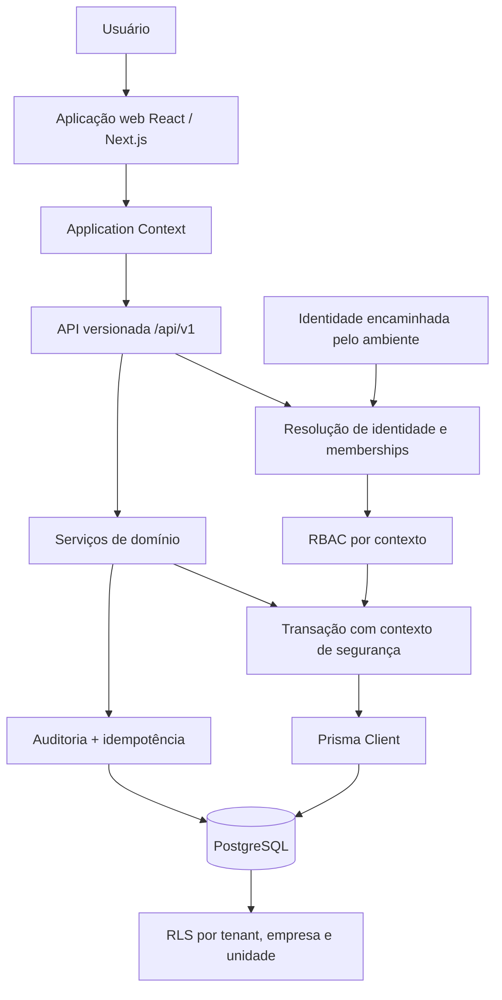
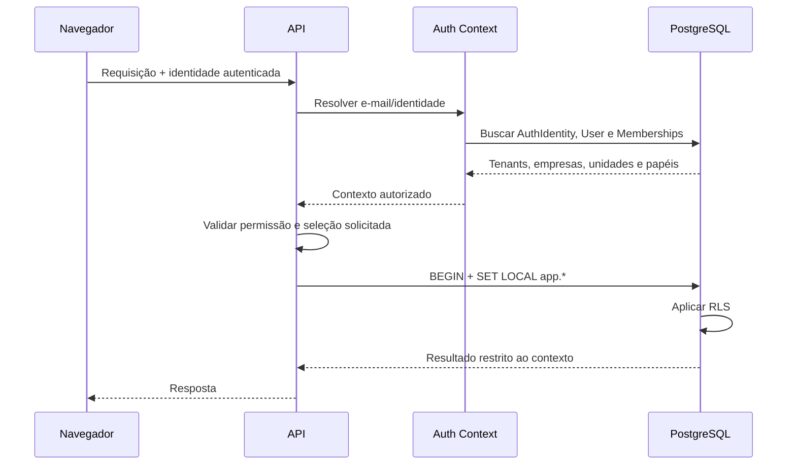
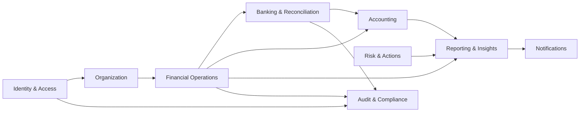

# Mourão Clareza Contábil e Financeira

## Dossiê técnico, arquitetural e operacional de handoff

**Data do dossiê:** 09/10/2026  
**Último estado verificável do projeto:** 10/10/2026  
**Classificação atual:** produto em desenvolvimento; não homologado para produção  
**Raiz histórica mais recente:** `C:\Users\leona\Documents\Codex\2026-07-24\files-mentioned-by-the-user-voc\outputs\Clareza-fase-0`  
**Branch registrada:** `master`  
**Último checkpoint seguro registrado:** `1a49d1f`

---

## 1. Resumo executivo

O Mourão Clareza Contábil e Financeira é uma aplicação web de gestão financeira, contábil e empresarial. O projeto não é apenas um protótipo visual: possui frontend executável, API versionada, modelo PostgreSQL, Prisma, autenticação contextual, RBAC, Row-Level Security, auditoria, idempotência e operações financeiras reais.

O desenho vigente é um **monólito modular**. Essa decisão é adequada para o estágio atual: reduz complexidade operacional e permite manter transações, autorização e auditoria no mesmo limite de consistência. A recomendação é fortalecer os módulos internos e os contratos antes de discutir microsserviços.

As Fases 0, 1 e 2 foram registradas como aprovadas. A Fase 3 estava em andamento e já continha uma primeira fundação bancária — importação CSV/OFX, modelo de conciliação, migration `0007`, APIs, deduplicação e proteção concorrente. Em paralelo, iniciou-se um rebranding para “Mourão Clareza Contábil e Financeira”. Esse rebranding permanece **não versionado**. Na auditoria de 10/10/2026, 61 de 63 testes passaram; as duas falhas são ocorrências da mesma expectativa desatualizada de título no teste de HTML renderizado.

O produto ainda não deve ser declarado pronto para produção. Faltam, entre outros pontos: concluir e versionar o rebranding, fechar o fluxo de conciliação e reversão, substituir todos os dados demonstrativos por dados reais claramente identificados, consolidar autenticação e administração de acessos, implantar observabilidade e CI/CD, validar recuperação de desastre e realizar uma homologação completa com dados fictícios representativos.

### Situação em uma página

| Área | Estado mais recente registrado | Observação |
| --- | --- | --- |
| Arquitetura | Monólito modular web | Decisão adequada ao estágio atual. |
| Frontend | Funcional e responsivo | Parte dos painéis ainda usa dados demonstrativos. |
| Backend/API | APIs v1 e serviços de domínio | Financeiro e identidade possuem implementação real. |
| Banco | PostgreSQL + Prisma | RLS, constraints, triggers e migrations SQL. |
| Multiempresa | Implementado | Tenant, empresa e unidade derivados da sessão. |
| Autorização | RBAC + fail-closed | Aplicado às APIs implementadas. |
| Auditoria | Implementada em operações críticas | Precisa virar serviço transversal obrigatório. |
| Idempotência | Implementada | Protege escritas financeiras e importações. |
| Fase 0 | Aprovada | 40/40 no gate registrado; commit `8278aba`. |
| Fase 1 | Aprovada | Identidade/contexto; commit `898f71c`. |
| Fase 2 | Aprovada no estado de retomada | Núcleo financeiro e checkpoints posteriores. |
| Fase 3 | Em andamento | Importação bancária existe; conciliação/reversão incompletas. |
| Rebranding | Em andamento, sem commit | 61/63 testes; duas ocorrências da expectativa antiga de título. |
| Produção | Não implantada | Não usar dados reais até novo gate. |

---

## 2. Fonte de verdade e grau de confiança

Este dossiê foi composto a partir dos relatórios e checkpoints técnicos do projeto, incluindo:

- validação real da Fase 0;
- relatórios da Fase 2;
- estado atual e roadmap do repositório;
- relatório de retomada de 04/08/2026;
- resultados de testes e revisões adversariais;
- registros de commits e do working tree;
- inventário de arquivos alterados durante a implementação.

### Estado que a equipe deve considerar

1. **Checkpoint Git seguro:** `1a49d1f`.
2. **Working tree posterior:** rebranding não consolidado, com oito arquivos modificados e quatro ativos em `public/brand`.
3. **Resultado atual do rebranding:** 61 de 63 testes; as duas falhas reproduzem a expectativa antiga de título.
4. **Validação visual final do rebranding:** não concluída.
5. **Deploy de produção:** não realizado.
6. **Dados reais:** não usados como base do desenvolvimento registrado.

O repositório foi relido e empacotado em 10/10/2026. A equipe ainda deve iniciar pelo `git status`, comparar o working tree com o checkpoint `1a49d1f` e transformar o estado recebido em um novo checkpoint versionado após revisar o rebranding.

---

## 3. Visão de produto

### 3.1 Objetivo principal

Entregar uma visão clara, auditável e orientada a decisão sobre a situação financeira e contábil de organizações com múltiplas empresas e unidades, reduzindo dependência de planilhas dispersas e interpretações manuais.

### 3.2 Capacidades de negócio existentes ou iniciadas

- navegação por tenant, empresa e unidade;
- contas a pagar e contas a receber;
- cadastros financeiros auxiliares;
- baixa parcial e total;
- juros, multa e desconto;
- estornos append-only;
- histórico financeiro cronológico;
- importação de movimentações bancárias CSV/OFX;
- deduplicação e idempotência;
- fundação de conciliação bancária;
- Central de Comando com indicadores, caixa, DRE, liquidez, riscos e pendências;
- glossário e explicações de conceitos;
- identidade, permissões e contexto organizacional.

### 3.3 Resultados de negócio esperados

- visão consolidada sem perder segregação por empresa/unidade;
- rastreabilidade de toda mutação financeira;
- redução de pagamentos, recebimentos e importações duplicadas;
- conciliação bancária consistente;
- explicação simples de indicadores contábeis;
- preparação segura para integrações bancárias, contábeis e fiscais.

### 3.4 Fora do escopo comprovado hoje

- folha de pagamento;
- estoque;
- compras e vendas completas;
- CRM;
- emissão fiscal nativa dentro do Clareza;
- escrituração contábil completa;
- fechamento fiscal automatizado;
- produção multi-região ou alta disponibilidade comprovada.

Esses itens podem integrar a visão futura, mas não devem ser vendidos como existentes.

---

## 4. Arquitetura atual

### 4.1 Visão de componentes



### 4.2 Estilo arquitetural

- **Monólito modular:** frontend, API e casos de uso no mesmo repositório.
- **API interna versionada:** rotas sob `/api/v1`.
- **Banco relacional como limite de consistência:** transações garantem operação, auditoria e idempotência atômicas.
- **Defesa em profundidade:** validação de entrada, RBAC no servidor, contexto transacional e RLS no banco.
- **Evolução por fatias verticais:** cada etapa agrega modelo, migration, serviço, API, interface, teste e documentação.

### 4.3 Decisão recomendada

Manter o monólito modular até que existam métricas que justifiquem uma separação. Separar serviços agora criaria custos de consistência distribuída, autenticação entre serviços, tracing, deploy e reprocessamento sem benefício comprovado.

---

## 5. Mapa do repositório e inventário do código

O inventário abaixo contém os arquivos e responsabilidades comprovados no histórico. A equipe deve gerar um manifesto automático atualizado antes de iniciar alterações.

```text
Clareza-fase-0/
├── app/                         # UI, contexto da aplicação e rotas HTTP
│   ├── page.tsx
│   ├── application.tsx
│   ├── application-context.tsx
│   ├── identity-client.ts
│   ├── command-center.tsx
│   ├── financial-workspace.tsx
│   ├── globals.css
│   └── api/v1/...               # Endpoints versionados
├── server/                      # Casos de uso, autorização e persistência
│   ├── auth-context.mjs
│   ├── financial-records.mjs
│   ├── financial-events.mjs
│   ├── financial-catalogs.mjs
│   └── ...                      # Identidade, tenant, Prisma e módulos bancários
├── prisma/
│   ├── schema.prisma
│   ├── seed.sql
│   ├── phase-zero-seed.sql
│   └── migrations/
│       ├── 0001_init/
│       ├── 0002_identity_bootstrap_and_branch_rls/
│       ├── 0003_financial_api_foundation/
│       ├── 0004_.../
│       ├── 0005_financial_operations/
│       ├── 0006_phase_two_hardening/
│       └── 0007_...             # Fundação de importação/conciliação bancária
├── tests/
│   ├── auth-context.test.mjs
│   ├── identity-interface.test.mjs
│   ├── financial-records.test.mjs
│   ├── rendered-html.test.mjs
│   └── integration/
│       └── postgresql-phase-zero.test.mjs
├── docs/
│   ├── ESTADO_ATUAL.md
│   ├── ROADMAP_MASTER.md
│   ├── DECISOES_ARQUITETURAIS.md
│   ├── PROTOCOLO_DE_FASES.md
│   ├── ARCHITECTURE.md
│   ├── MODULES.md
│   ├── DESIGN_SYSTEM.md
│   ├── API.md
│   ├── DATABASE.md
│   ├── FASE_0_VALIDACAO_REAL.md
│   ├── RETOMADA_MOURAO_CLAREZA_2026-08-04.md
│   └── fases/
│       ├── FASE_2_NUCLEO_FINANCEIRO.md
│       └── FASE_3_CONCILIACAO.md
├── public/
│   ├── brand/                   # Quatro ativos do rebranding, ainda não consolidados
│   └── og.png                   # Substituição estava pendente/sem gate final
├── worker/                      # Entrada do runtime de hospedagem
├── generated/prisma/            # Cliente Prisma gerado
├── .env.example
├── docker-compose.yml
├── prisma.config.ts
├── package.json
└── README.md
```

### 5.1 Responsabilidade dos principais arquivos

| Arquivo/módulo | Responsabilidade |
| --- | --- |
| `app/page.tsx` | Entrada da aplicação. |
| `app/application.tsx` | Composição da aplicação autenticada. |
| `app/application-context.tsx` | Estado de identidade, empresa/unidade ativa, permissões e troca segura de contexto. |
| `app/identity-client.ts` | Contrato e parsing da resposta de identidade; preferências do cliente tratadas como não confiáveis. |
| `app/command-center.tsx` | Central de Comando e módulos de visualização. |
| `app/financial-workspace.tsx` | Operações reais de títulos, baixas, estornos e histórico. |
| `server/auth-context.mjs` | Resolve identidade externa, usuário, memberships, escopo e permissões. |
| `server/financial-records.mjs` | Criação e leitura de títulos financeiros, concorrência e idempotência. |
| `server/financial-events.mjs` | Baixas, recebimentos, estornos e projeções financeiras. |
| `server/financial-catalogs.mjs` | Contrapartes, categorias, centros de custo e contas financeiras. |
| `prisma/schema.prisma` | Modelo relacional consumido pelo Prisma. |
| `prisma/migrations/*` | SQL autoritativo para tabelas, policies, triggers, constraints e hardening. |
| `tests/integration/*` | Prova real de RLS, RBAC, transação, concorrência e isolamento no PostgreSQL. |

### 5.2 O que “todo o código” significa neste handoff

O código-fonte não foi duplicado dentro deste Markdown porque isso criaria uma segunda cópia desatualizada e difícil de auditar. A fonte permanece no repositório. Este documento inventaria o código, descreve seus contratos e informa onde cada responsabilidade está localizada.

Antes do recebimento formal, a equipe deve gerar:

```powershell
git status --short
git rev-parse HEAD
git diff --stat
git ls-files
rg --files app server prisma tests docs public worker
```

O resultado deve ser salvo como `docs/HANDOFF_FILE_MANIFEST_YYYY-MM-DD.md` e comparado com a árvore acima.

---

## 6. Modelo de domínio e dados

### 6.1 Organização e acesso

| Entidade | Papel |
| --- | --- |
| `Tenant` | Limite superior de isolamento. |
| `Company` | Empresa pertencente ao tenant. |
| `Branch` | Unidade/filial de uma empresa. |
| `User` | Usuário interno. |
| `AuthIdentity` | Associação entre identidade externa e usuário interno. |
| `Membership` | Vínculo do usuário com tenant, empresa ou unidade. |
| `Role` | Papel de negócio. |
| `Permission` | Ação autorizável. |
| `RolePermission` | Relação entre papel e permissão. |

### 6.2 Financeiro

| Entidade | Papel |
| --- | --- |
| `Payable` | Título a pagar. |
| `Receivable` | Título a receber. |
| `Payment` | Evento append-only de pagamento. |
| `PaymentReversal` | Evento de reversão de pagamento. |
| `Receipt` | Evento append-only de recebimento. |
| `ReceiptReversal` | Evento de reversão de recebimento. |
| Contraparte | Pessoa/empresa relacionada ao título. |
| Categoria financeira | Classificação gerencial. |
| Centro de custo | Dimensão de alocação. |
| Conta financeira | Conta caixa/bancária utilizada. |

O saldo e o status são projeções derivadas dos eventos. O hardening da Fase 2 passou a proteger essas projeções contra alterações diretas pela role de runtime.

### 6.3 Contabilidade e gestão

- `JournalEntry` e `JournalEntryLine` para lançamentos contábeis;
- regras de equilíbrio entre débito e crédito;
- proteção de lançamentos postados;
- `PendingItem`, `Risk` e `ActionPlan` para gestão;
- `GlossaryTerm` para conhecimento contextual.

### 6.4 Segurança e rastreabilidade

- `AuditLog` registra ator, sessão, contexto, ação, entidade, antes/depois, metadados, redação e hash;
- `IdempotencyRecord` associa chave, operação, usuário, tenant, hash da requisição e resposta;
- migrations aplicam RLS e constraints compostas para impedir relações entre escopos incompatíveis.

### 6.5 Banco e conciliação

O estado de retomada registra:

- parser de arquivos CSV e OFX;
- importação bancária transacional;
- modelo criado pela migration `0007`;
- APIs de importações e movimentações;
- deduplicação;
- proteção contra importações concorrentes;
- paginação vinculada ao contexto e aos filtros;
- fundação para conciliações `1:1`, `1:N` e `N:1`.

Os nomes exatos de tabelas e endpoints bancários precisam ser confirmados em `schema.prisma`, `0007` e `docs/API.md` no gate inicial. Não devem ser adivinhados pela nova equipe.

---

## 7. Identidade, sessão, autorização e isolamento

### 7.1 Fluxo atual



### 7.2 Variáveis transacionais conhecidas

```text
app.tenant_id
app.user_id
app.company_ids
app.branch_ids
app.tenant_wide_access
```

### 7.3 Propriedades de segurança implementadas

- o navegador não define livremente tenant, empresa ou unidade;
- a seleção solicitada é comparada ao escopo interno;
- ausência de identidade, membership ou permissão falha de forma fechada;
- a role `clarity_app` não possui `BYPASSRLS`;
- RLS considera tenant, empresas e unidades;
- contexto incompleto retorna zero dados ou nega autorização;
- relações cruzadas são bloqueadas por RLS ou constraints;
- o pool reutilizado foi testado para não vazar contexto;
- auditoria e idempotência participam da mesma transação das escritas críticas.

### 7.4 Lacunas de identidade

- definição final do provedor de identidade de clientes;
- sessão própria, rotação, revogação e expiração;
- MFA para perfis privilegiados;
- login, logout e recuperação de acesso;
- convites e ciclo de vida de usuários;
- administração de papéis e permissões;
- auditoria de login, logout e negações;
- revisão periódica de acessos;
- políticas de senha caso autenticação local venha a existir.

---

## 8. API atual

### 8.1 Identidade

#### `GET /api/v1/me`

Retorna a identidade autenticada, tenants, memberships, empresas, unidades e permissões aplicáveis. Respostas registradas:

- `401`: identidade ausente;
- `403`: identidade sem vínculo/acesso interno;
- `503`: banco não configurado.

### 8.2 Contas a pagar

- `GET /api/v1/payables`
- `POST /api/v1/payables`
- `POST /api/v1/payables/settlements`
- `POST /api/v1/payables/reversals`
- `GET /api/v1/payables/history`

### 8.3 Contas a receber

- `GET /api/v1/receivables`
- `POST /api/v1/receivables`
- `POST /api/v1/receivables/settlements`
- `POST /api/v1/receivables/reversals`
- `GET /api/v1/receivables/history`

### 8.4 Catálogos financeiros

- `GET /api/v1/financial/catalogs`
- `POST /api/v1/financial/catalogs`

### 8.5 Banco/conciliação

Há três endpoints bancários registrados no checkpoint, cobrindo importações e movimentações. Os caminhos exatos devem ser obtidos de `docs/API.md` e das rotas do repositório no gate inicial.

### 8.6 Garantias transversais esperadas

- validação de corpo e limites de tamanho;
- valores monetários como decimal/string, sem `float`;
- cursor opaco vinculado ao contexto e filtros;
- `Idempotency-Key` obrigatório em comandos que não podem duplicar;
- status HTTP estáveis e erros estruturados;
- escopo derivado no servidor;
- auditoria atômica;
- transação única para comando, projeção, auditoria e idempotência.

### 8.7 Melhorias de contrato

1. Publicar OpenAPI como artefato versionado.
2. Padronizar envelope de erro com `code`, `message`, `correlationId` e `details` seguros.
3. Formalizar versionamento e política de compatibilidade.
4. Adicionar `ETag`/controle de concorrência onde aplicável.
5. Medir latência, erro e volume por endpoint.
6. Criar testes de contrato independentes do frontend.

---

## 9. Interface e experiência

### 9.1 O que existe

- Central de Comando responsiva;
- navegação lateral;
- seleção real de empresa e unidade;
- cartões de indicadores;
- receita, resultado, caixa, contas a pagar e receber;
- projeção de caixa e liquidez;
- DRE explicada;
- saúde empresarial;
- riscos e pendências;
- glossário, busca e notificações;
- drawers, popovers e estados de interação;
- área operacional financeira real separada dos indicadores demonstrativos.

### 9.2 Dados demonstrativos

Historicamente, indicadores, DRE, caixa, saúde, pendências, notificações e glossário foram alimentados por constantes no frontend. A Fase 1 removeu identidades e empresas fictícias do contexto operacional, mas nem todos os painéis foram ligados a dados reais.

Regra obrigatória para continuidade:

- dados reais devem ser buscados pela API;
- dados de demonstração precisam de selo visual inequívoco;
- nunca misturar números reais e simulados no mesmo agregado;
- toda afirmação como “atualizado”, “conciliado” ou “protegido” deve ter fonte técnica verificável.

### 9.3 Rebranding em andamento

Nome institucional: **Mourão Clareza Contábil e Financeira**  
Nome curto: **Mourão Clareza**

Estado registrado:

- oito arquivos modificados;
- quatro ativos novos em `public/brand`;
- logo canônica aplicada na entrada;
- brasão aplicado no menu;
- paleta azul-marinho, dourado e marfim;
- sidebar ampliada;
- textos públicos e metadata renomeados;
- identificadores técnicos `clareza-*` preservados por compatibilidade;
- `public/og.png`, documentação e validação final ainda pendentes no checkpoint de retomada.

Uma tentativa posterior gerou um novo Open Graph, mas o processo foi interrompido antes do gate. A equipe deve verificar se esse ativo está realmente no repositório e se respeita a marca.

---

## 10. Histórico técnico e checkpoints

| Marco | Evidência |
| --- | --- |
| Baseline documental | commit `6806650` |
| Fase 0 | commit `8278aba`; PostgreSQL real; 40/40 |
| Fase 1 | commit `898f71c`; identidade e contexto |
| Checkpoint seguro mais recente | `1a49d1f` |
| Fases aprovadas no relatório de retomada | 0, 1 e 2 |
| Fase ativa | 3 — conciliação |
| Working tree | rebranding sem commit |
| Testes no working tree em 10/10/2026 | 61/63; duas falhas equivalentes no título antigo |

### 10.1 Fase 0 — fundação

- migrations `0001` a `0003` em PostgreSQL 16;
- seed idempotente;
- schema Prisma alinhado ao banco;
- isolamento tenant/empresa/unidade;
- fail-closed sem usuário;
- concorrência de idempotência;
- rollback atômico quando auditoria/idempotência falham;
- auditoria append-only e hash;
- remoção de senhas locais padrão de arquivos versionados.

### 10.2 Fase 1 — identidade e contexto

- `/api/v1/me` consumido pelo frontend;
- cliente central de identidade;
- provider de contexto;
- seletores reais de empresa e unidade;
- permissões influenciando a UX;
- preferências locais tratadas como não confiáveis;
- remount e proteção contra respostas antigas em troca de contexto;
- estados 401, 403, 503 e erro explícitos.

### 10.3 Fase 2 — operações financeiras

- catálogos financeiros;
- títulos a pagar/receber;
- baixas parciais e totais;
- juros, multa e desconto;
- estornos;
- projeção de saldo/status;
- timeline cronológica;
- proteção de referências entre unidades;
- hardening contra mutação direta de projeções;
- datas futuras e timestamps não finitos bloqueados;
- proteção concorrente para não exceder saldo;
- interface responsiva e somente leitura por permissão.

### 10.4 Fase 3 — conciliação

Concluído/iniciado:

- parser CSV/OFX;
- migration `0007`;
- importação transacional;
- APIs de importações e movimentações;
- deduplicação, auditoria e idempotência;
- isolamento por contexto;
- proteção contra importações concorrentes;
- paginação vinculada a contexto e filtros;
- revisão adversarial do bloco sem P0/P1/P2.

Pendente:

- serviços e APIs transacionais de conciliação;
- reversão append-only;
- cenários `1:1`, `1:N` e `N:1`;
- conflitos de soma, moeda, conta e escopo;
- interface operacional completa;
- relatórios de exceção e reconciliação.

---

## 11. Estratégia de testes e evidências

### 11.1 Gates usados

```text
npm test
npm run lint
npm run typecheck
npm run build
npm run db:validate
npm run test:integration
git diff --check
node --check
```

### 11.2 Evidências históricas

- Fase 0: 21 testes locais + 19 integrações PostgreSQL = 40/40;
- Fase 1: 37 testes locais + 20 integrações em um gate intermediário;
- Fase 2: gates locais chegaram a 45/45; revisão adversarial sem P0/P1 após correções;
- auditoria de 10/10/2026: 61/63; duas ocorrências da mesma expectativa desatualizada de título;
- validações anteriores incluíram build, lint, TypeScript, Prisma e integridade do diff.

As contagens pertencem a checkpoints diferentes e não devem ser somadas.

### 11.3 Cobertura crítica registrada

- RLS e RBAC;
- isolamento por tenant, empresa e unidade;
- pool sem vazamento de contexto;
- idempotência concorrente;
- auditoria e rollback;
- criação/listagem financeira;
- baixa parcial/total e estorno;
- imutabilidade de eventos;
- datas financeiras de Manaus;
- importações concorrentes e duplicidade;
- identidade, storage e troca de contexto;
- renderização e contratos HTML.

### 11.4 Lacunas de qualidade

- teste visual automatizado do rebranding;
- E2E completo em navegador com banco real;
- testes de carga e limites;
- chaos/recovery de transações interrompidas;
- mutation testing de regras financeiras;
- cobertura formal de acessibilidade;
- matriz de compatibilidade de navegadores;
- testes de backup e restauração;
- SAST, secret scanning e análise de dependências em CI.

---

## 12. Riscos atuais

| Risco | Severidade | Tratamento |
| --- | --- | --- |
| Working tree não consolidado | Alta | Preservar, auditar diff e criar checkpoint isolado. |
| Interface mistura real e demonstrativo | Alta | Rotular mocks e substituir por APIs. |
| Autenticação do produto incompleta | Alta | Definir IdP, sessão, MFA e ciclo de vida. |
| Rebranding sem gate visual/build | Média/alta | Finalizar desktop/mobile, testes e docs. |
| Dependências com alertas históricos | Média | Reexecutar auditoria e atualizar por compatibilidade. |
| Ausência de CI/CD comprovado | Alta | Pipeline com gates, artefatos e rollback. |
| Observabilidade limitada | Alta | Logs estruturados, métricas, tracing e alertas. |
| Backup/DR não comprovado | Alta | RPO/RTO, restore testado e runbook. |
| Regras fiscais/contábeis podem mudar | Alta | Versionar regras e exigir validação especialista. |
| Crescimento sem modularização explícita | Média | Limites de módulo e dependências verificadas. |

---

## 13. Arquitetura-alvo recomendada

### 13.1 Módulos internos



Cada módulo deve ter:

- contratos públicos explícitos;
- casos de uso sem dependência da UI;
- adaptadores de persistência;
- autorização no limite de entrada;
- eventos/auditoria padronizados;
- testes unitários e de integração próprios;
- dono técnico e documentação.

### 13.2 Estrutura sugerida

```text
src/
├── modules/
│   ├── identity/
│   ├── organization/
│   ├── finance/
│   ├── banking/
│   ├── accounting/
│   ├── reporting/
│   └── audit/
├── platform/
│   ├── database/
│   ├── http/
│   ├── observability/
│   ├── security/
│   └── jobs/
├── web/
└── shared/
```

Não é obrigatório mover imediatamente a árvore atual. Primeiro introduza regras de dependência e módulos; movimentos físicos só devem ocorrer com imports automatizados e regressão verde.

### 13.3 Eventos e jobs

Para tarefas demoradas — importações, recálculos, geração de relatórios e integrações — introduzir uma fila/outbox transacional. O comando grava domínio + outbox na mesma transação; um worker processa com idempotência e retry exponencial.

### 13.4 Observabilidade

- `correlationId` por requisição;
- logs JSON sem PII/segredos;
- métricas por endpoint e caso de uso;
- tracing de banco e jobs;
- alertas por erro, latência, fila e falha de integração;
- trilha de auditoria separada de logs operacionais;
- dashboard de saúde com SLOs.

---

## 14. Roadmap recomendado

### Etapa 0 — recepção e congelamento

Objetivo: estabelecer uma fonte de verdade confiável.

1. Preservar cópia imutável do diretório original.
2. Confirmar `HEAD`, branch, status, diff e remotes.
3. Gerar inventário e hashes.
4. Executar secret scanning antes de publicar o repositório.
5. Reinstalar dependências a partir do lockfile.
6. Rodar todos os gates locais e PostgreSQL.
7. Registrar discrepâncias em um novo `ESTADO_ATUAL.md`.

### Etapa 1 — concluir o rebranding

1. Auditar os oito arquivos e quatro ativos não versionados.
2. Atualizar o teste do título.
3. Confirmar logo, brasão, favicon, metadata e Open Graph.
4. Validar 1440 px e 390 px em navegador real.
5. Verificar contraste, foco, cortes, rolagem e fontes.
6. Atualizar README e documentação.
7. Rodar gate completo.
8. Criar commit exclusivo de rebranding.

### Etapa 2 — concluir conciliação

1. Fechar modelo e invariantes.
2. Implementar conciliação e reversão transacionais.
3. Cobrir `1:1`, `1:N`, `N:1` e conflitos.
4. Implementar sugestões sem confirmação automática indevida.
5. Construir fila de exceções.
6. Entregar interface operacional.
7. Repetir revisão adversarial financeira.

### Etapa 3 — dados reais de gestão

1. Ligar indicadores a consultas versionadas.
2. Definir dicionário de métricas.
3. Construir DRE e fluxo de caixa explicáveis.
4. Implementar drill-down até o evento de origem.
5. Marcar competência, atualização e fonte de cada número.

### Etapa 4 — identidade e administração

1. Definir IdP e sessão.
2. Adicionar MFA e recuperação.
3. Implementar convites, suspensão e revogação.
4. Criar matriz de papéis/permissões.
5. Criar revisão periódica de acessos.

### Etapa 5 — operação e produção

1. CI/CD com ambientes dev, teste, homologação e produção.
2. Banco gerenciado, backups e restore testado.
3. Observabilidade e alertas.
4. Política LGPD, retenção e exclusão.
5. Pentest e revisão de arquitetura.
6. Plano de rollout e rollback.
7. Homologação formal do negócio.

### Etapa 6 — integração fiscal

Integrar ao Aurora por contrato de serviço, não por compartilhamento de banco ou import direto de código. O Clareza cria um pedido fiscal idempotente; o Aurora devolve estados, XML, DANFSe, rejeições e identificadores oficiais.

---

## 15. Melhorias recomendadas

### Prioridade imediata

- consolidar Git e working tree;
- remover ambiguidades entre mock e real;
- formalizar OpenAPI;
- padronizar erros e correlação;
- finalizar autenticação;
- automatizar CI e testes PostgreSQL;
- adicionar varredura de segredos e dependências;
- documentar migração e rollback.

### Prioridade seguinte

- modularização explícita;
- outbox/jobs;
- observabilidade completa;
- testes E2E e acessibilidade;
- backup/restore;
- catálogo de métricas;
- feature flags para rollout progressivo.

### Evolução estrutural

- ledger/eventos financeiros como fonte imutável;
- projeções reconstruíveis;
- fechamentos contábeis com período bloqueado;
- versionamento de regras;
- trilha de aprovação para ações sensíveis;
- integração fiscal assíncrona e idempotente.

---

## 16. Critérios de aceite

### 16.1 Definição de pronto por funcionalidade

- regra de negócio documentada;
- autorização e isolamento testados;
- migration reversível ou plano de recuperação;
- API versionada e documentada;
- interface com loading, vazio, erro e permissão;
- auditoria e idempotência quando aplicáveis;
- testes locais, integração e E2E;
- observabilidade adicionada;
- documentação e changelog atualizados;
- revisão sem P0/P1.

### 16.2 Gate para produção

- zero dados demonstrativos apresentados como reais;
- autenticação e MFA homologados;
- RLS validada no banco de destino;
- restore de backup comprovado;
- migrations testadas em cópia representativa;
- pentest sem crítico/alto aberto;
- SLOs e alertas ativos;
- runbooks de incidente;
- aceite formal do negócio e da segurança;
- rollback ensaiado.

---

## 17. Onboarding da equipe

### Primeiras 48 horas

- ler `AGENTS.md` e toda a pasta `docs/`;
- conferir repositório e working tree;
- gerar manifesto;
- configurar PostgreSQL 16 descartável;
- rodar migrations e seed duas vezes;
- executar todos os testes;
- abrir aplicação em desktop e mobile;
- listar divergências deste dossiê.

### Primeira semana

- encerrar rebranding;
- definir owners por módulo;
- implantar pipeline CI;
- aprovar ADRs de autenticação, jobs e observabilidade;
- refinar backlog da Fase 3;
- registrar riscos e dependências externas.

### Papéis mínimos

- tech lead/arquitetura;
- engenharia frontend;
- engenharia backend/dados;
- QA/automação;
- DevOps/SRE;
- segurança/LGPD;
- especialista financeiro-contábil;
- product owner.

---

## 18. Questões que exigem decisão

1. Qual será o provedor de identidade definitivo?
2. O produto atenderá um único grupo ou será SaaS multi-tenant?
3. Quais módulos são MVP comercial?
4. Quais indicadores têm definição contábil oficial?
5. Qual o fluxo de aprovação para baixa, estorno e conciliação?
6. Quem pode visualizar e exportar auditoria?
7. Quais RPO, RTO e requisitos de disponibilidade?
8. Qual política de retenção e anonimização?
9. O Aurora será integração interna, serviço separado ou produto autônomo?
10. Quais bancos, formatos e fornecedores entram primeiro?

---

## 19. Procedimento de retomada

```powershell
Set-Location 'C:\Users\leona\Documents\Codex\2026-07-24\files-mentioned-by-the-user-voc\outputs\Clareza-fase-0'

git status --short
git branch --show-current
git rev-parse HEAD
git diff --check
npm.cmd ci
npm.cmd run db:validate
npm.cmd run typecheck
npm.cmd run lint
npm.cmd test
npm.cmd run build
```

Em PostgreSQL descartável, aplicar migrations, executar seed duas vezes e rodar `npm.cmd run test:integration`. Não usar banco de produção nessa retomada.

Depois:

1. comparar o resultado com `1a49d1f`;
2. revisar o diff de rebranding;
3. corrigir o teste do título;
4. validar desktop/mobile;
5. pedir revisão independente;
6. versionar o checkpoint;
7. retomar a Fase 3.

---

## 20. Veredito

O Clareza possui uma fundação técnica acima de um protótipo comum: isolamento real, banco relacional, controle de acesso, auditoria, idempotência, operações financeiras e testes de integração. O principal risco não é ausência de base; é a transição incompleta entre fundação, produto operacional e produção.

A equipe deve preservar o que já existe, evitar reescrita total e concluir as fatias iniciadas com disciplina de gates. O caminho de maior valor é: **estabilizar o repositório, concluir a marca, fechar conciliação, substituir mocks por dados rastreáveis, fortalecer identidade/operação e só então preparar produção**.
